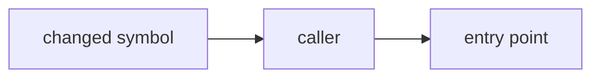

# PR risk

Judge what can go wrong once a PR is merged, how bad it is, and how many
humans must review it. This is **not** a code review: never comment on style,
naming, structure or code quality. Never judge CI status.

Write every report in English close to ASD-STE100: short sentences, one idea
per sentence, active voice, common words.

## 1. Find the target

- Argument is a number, a PR URL or a branch:
  `gh pr view <arg> --json number,title,body,baseRefName,headRefOid,url,state`.
- No argument: same command without `<arg>`, on the current branch.
- Set `R=<owner>/<repo>` from the `url` field (`https://github.com/<owner>/<repo>/pull/<N>`).
  Use `-R "$R"` and `repos/$R/...` in every later `gh` command. Never rely
  on the current directory to find the repository: a PR URL can point to
  another repository.
- Files, with their size, from GitHub (paginated, no 100-file limit):
  `gh api "repos/$R/pulls/<N>/files" --paginate --jq '.[] | "\(.status)\t+\(.additions)/-\(.deletions)\t\(.filename)"'`.
- No PR exists (`gh pr view` fails): **no-PR mode**. Base is
  `gh repo view --json defaultBranchRef --jq .defaultBranchRef.name`. Head is
  the branch argument, or `HEAD` when there is none. Files come from
  `git fetch -q origin <base> && git diff --numstat origin/<base>...<head>`.
- `gh` is not authenticated, or no GitHub repository can be resolved: stop
  and say so. Give no partial verdict.
- A merged or closed PR is still judged. Judge the change, not its state.

## 2. Read the context, cheaply

- The PR title and body, from step 1.
- The repo's `CLAUDE.md`: read only a section named "Sensitive zones" if it
  exists. Each entry is a path glob and a reason. No section: continue.

## 3. Sort the files

Put each changed file in one group. Do not read diffs yet.

- **Skip** (count only): tests, docs, ADRs, specs and plans, generated files,
  lockfiles with a matching manifest change, snapshots, assets.
- **Read**: everything else — production code, config, SQL, CI and build
  files, dependency manifests, translations and labels shown to users, files
  that match a sensitive zone, deleted production files.

A Read group that is empty: do not read any diff. Go to step 5.

## 4. Read the selected diffs

PR mode — the local checkout can be stale and the base branch can be gone,
so read from GitHub:

```bash
gh api "repos/$R/pulls/<N>/files" --paginate --jq '.[]
  | select(.filename | IN("<path 1>", "<path 2>"))
  | "### \(.filename)\n\(.patch // "(no patch: binary or too large)")"'
```

A file with no patch is too large for the API: list it under "Not read".
No-PR mode: `git diff origin/<base>...<head> -- <files>`.
Never check out the PR. To read a whole file at the PR head, use
`gh api "repos/$R/contents/<path>?ref=<headRefOid>" --jq .content | base64 -d`.

Budget: about 1500 changed lines, counted as the sum of `additions` and
`deletions` of the Read group before you read. Over budget, read in this order: SQL and
migrations, sensitive zones, security, clinical code, CI/build/dependencies,
other production code. List every Read-group file you did not read. Unread
production code is itself a risk: it can raise the tier, never lower it.

**Blast radius** — only when a danger already points to Medium or High: find
who uses the changed public symbols (methods, endpoints, config keys,
columns, dependencies). Use codebase-memory `trace_path` if the repo is
indexed, else `rg -l '<symbol>'`. Stop at two levels. For a dependency bump
that is already Medium (new dependency, major bump), find the code that uses
the library and what happens when it throws. Never run a blast radius search
to look for a reason to raise a Low. Never read upstream changelogs or
release notes of a patch or minor bump.
`rg` searches the local checkout. If it is not at the PR head, add "callers
searched at <sha>, not at the PR head" to the "Not read" line.

## 5. Judge each danger

| # | Danger | Question |
|---|---|---|
| 1 | Irreversible | Does a `git revert` undo everything? (migration, data deletion, external write, published message, files deleted on users' machines) |
| 2 | Blast radius | How many things depend on what changes? (shared library, config default, widely called code, all API clients) |
| 3 | Silent failure | If it is wrong, will anyone notice? (defaults, swallowed errors, cache, timeouts, rounding, dates, `finally` cleanup) |
| 4 | Contract break | Does an external consumer break? (public API, DTO, OpenAPI, event format, renamed column, alert ids or labels) |
| 5 | Security | Does a trust boundary move? (auth, input validation, secrets, permissions, deserialization) |
| 6 | Build chain | Does what builds or ships the code change? (CI, Jenkinsfile, Gradle, dependencies) |
| 7 | Test gap | Is the changed behavior verified? (production change with no matching test, tests deleted or disabled, only stubs where real data matters) |
| 8 | Intent mismatch | Does the diff do more than, or other than, the title and body say? |
| 9 | Clinical correctness | Can a clinical output (dose, interaction, contraindication, alert, indicator, rule) change with no error raised? |

Rules:
- Judge from the diff, not from the title. A title that says "refactor" or
  "chore" proves nothing.
- Danger 8: compare each claim in the body with the diff. A claim that the
  diff contradicts ("X is unchanged" while X changes) is a mismatch. A commit
  that only aligns the branch with its base (the same change is already on
  the default branch) is not a mismatch. Empty body: write "No description:
  intent not checked." and raise nothing from danger 8.
- Danger 9 applies when the repo handles clinical content. Provisional or
  hand-made clinical data counts, even behind a flag, if the artifact that
  carries it ships to production or the data reaches any client.
- Report only dangers that are present. Each gets: file, one sentence on what
  can go wrong, one thing a reviewer must check.

## 6. Set the tier

The tier sets the number of humans. Never give one without the other, and
never change one alone.

| Tier | Humans | When |
|---|---|---|
| Low | 0 | No danger, or only a minor test gap. Docs, tests, additive change behind a flag, covered internal refactor, patch or minor bump of an existing dependency with no other change |
| Medium | 1 | At least one of dangers 2–7 present and contained |
| High | 2 | Danger 1; or a major danger with no test coverage; or a significant change in a sensitive zone |

Floors — apply after the table, they only raise:
- **At least Medium**: any migration (schema or data), any SQL that writes
  data; security code;
  a sensitive zone; intent mismatch; CI/build/dependency change **that moves
  trust** — secret exposed or permission widened in CI, a check/test/quality
  step removed, disabled or bypassed (`skip`, `|| true`,
  `continue-on-error`), a publish or deploy step changed, a **new**
  dependency, a **major** version bump.
- Other CI/build/dependency changes (task reorganized) get no floor. Judge
  them like any change; they are often Low.
- **Clinical**: Medium when a clinical output can change; High when no test
  pins the expected values on real data and the output reaches all clients.

Last question: *"Ignore the tier. Must a human see this specific change?"*
If yes, raise the tier and its human count together, and say why. Never
lower it. A Low verdict means 0 humans: if you want "a quick look", the
answer to this question is yes, so the tier is Medium. Skip this question
for a patch or minor bump of an existing dependency with no other change: it
stays Low, so two runs on the same bump give the same tier.

**Rollback**: say whether a `git revert` is enough. If not, say what else is
needed (data restore, two-step migration, consumer coordination, flag off).

## 7. Report

Keep both outputs short. Do not explain the method. Do not list commands.

Terminal, always:

```
PR #<N> · <TIER> · <0|1|2> human review(s)
Reason: <one sentence>
Dangers:
  1. [<Danger>] <file>: <what can go wrong>.
Intent: <matches the description | mismatch: <what> | No description: intent not checked.>
Rollback: <revert is enough | what else is needed>.
Not read: <files or "nothing">.
```

No-PR mode: print the terminal verdict, then the comment body below without
the marker, titled "Risk", for the user to paste into the PR description.
Post nothing.

PR mode: write the comment body to `${TMPDIR:-/tmp}/pr-risk-<N>.md`, then post it.

````
<!-- pr-risk -->
## PR risk: <TIER> · <0|1|2> human review(s)
**Reason:** <one sentence>

### Dangers

**1. <Danger>** · `<file>`
<what can go wrong and why it matters, 1–2 sentences>
→ **Check:** <one thing a reviewer must verify>

**2. <Danger>** · `<file>`
...

**Intent:** <matches the description | mismatch: <what> | No description: intent not checked.>

### Blast radius


### Rollback
<revert is enough | what else is needed>

<sub>Risk assessment, not a code review. Not read: <files or "nothing">.</sub>
````

- Low with no danger: replace the "Dangers" section with "No danger found."
- No table for dangers: long cells make GitHub columns too narrow to read.
  Keep the line breaks: GitHub shows each one in a comment.
- "Blast radius" only for Medium and High, and only with callers you found.
  Keep it under 10 nodes. Quote every node label.

Post without asking. Edit the existing comment, never add a second one:

```bash
F="${TMPDIR:-/tmp}/pr-risk-<N>.md"
ME=$(gh api user --jq .login)
ID=$(gh api "repos/$R/issues/<N>/comments" --paginate \
  --jq ".[] | select(.user.login == \"$ME\" and (.body | startswith(\"<!-- pr-risk -->\"))) | .id" | head -1)
if [ -n "$ID" ]; then
  gh api -X PATCH "repos/$R/issues/comments/$ID" -F body=@"$F" --jq .html_url
else
  gh pr comment <N> -R "$R" --body-file "$F"
fi
```
Print the comment URL.
