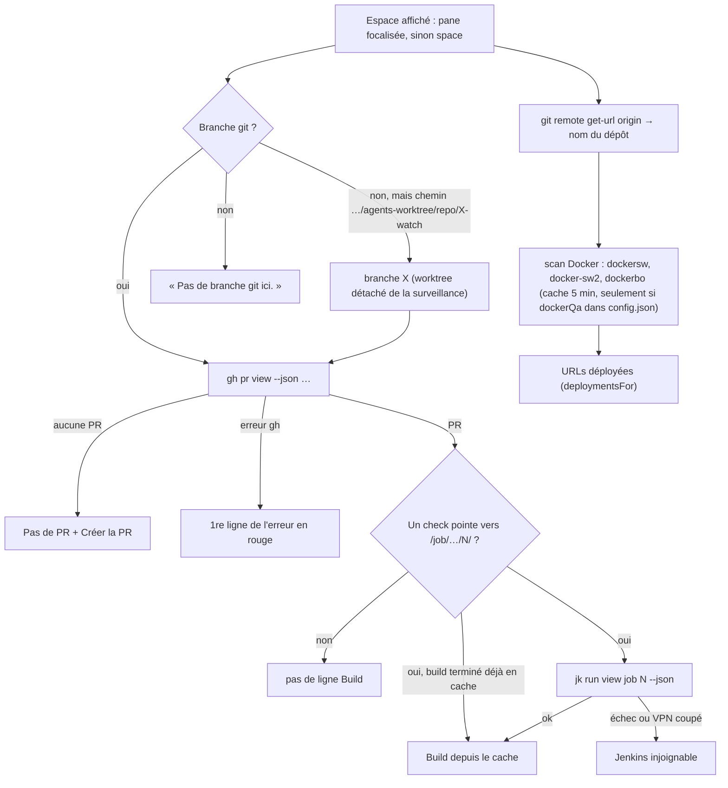
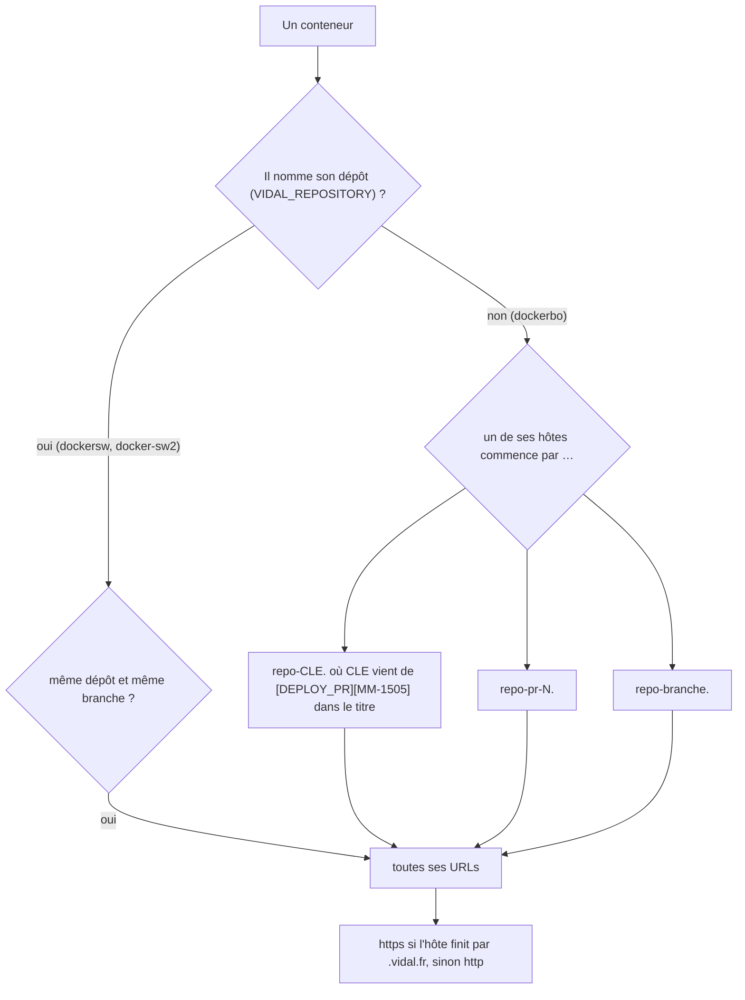

# Mod `pr` : le panneau Pull request

Notre mod (pas un clone). Il remplit trois blocs du panneau latéral du layout `jc`, choisis par sa prop `view` :

- `pr` (bouton Pull request de `tabs-jc`, `⌘⇧R`) : la PR de la branche affichée, son build Jenkins, où elle est déployée et ses checks ;
- `watch` (`view: watch`, bouton Surveillance des PR, `⌘⇧U`) : la **Surveillance**, la liste des PR que `status-jc` suit (un brouillon seulement tant qu'un space ou une pane montre sa branche), avec l'interrupteur, le bouton ⌨ « Travailler dessus » et le bouton pause. ⌨ ouvre un espace Claude dans le worktree de la PR : celui de la branche pour un brouillon, le `-watch` pour une PR prête, qui est alors mise en pause jusqu'à la fermeture de cet espace ; « ouverture… » puis l'éventuelle erreur s'affichent sous la ligne. Le panneau ne fait que l'afficher et écrire l'interrupteur, les pauses et les demandes d'ouverture (`shared("pr-open")`) ; toute la logique est dans [`status-jc`](../status-jc/README.md).

- `ci` (`view: ci`, bouton CI, `⌘⇧I`) : le dernier build Jenkins (ou les derniers runs GitHub Actions sans `jenkins` dans `config.json`) des branches longues des dépôts où j'ai contribué, avec **Corriger** (voir [plus bas](#ci-des-branches-longues-view-ci)).

## Ce que tu vois

```
Pull request                                  …  Rafraîchir
────────────────────────────────────────────────────────────
Titre de la PR                      ← clic : la PR sur GitHub
#482 [Ouverte] [Revue attendue] +120 −34
┌──────────┬───────────────────────────────────────────────┐
│ Build    │ ● #57 échec          9 min  [log] [relance]   │ ← clic sur la ligne : le build
│          │ 412 tests · 3 en échec · 2 ignorés           │
│ Déployée │ merlin-feat-x.dockersw.vidal.net             │ ← « nulle part » si rien, « … » pendant la recherche
│ Checks   │ ● 1 en échec · 2 ✓                        ›  │ ← clic : déplie la liste
│ Squash   │ ● 2 commits fixup! à squasher · merge… Squasher│ ← PR ouverte ; « rien à squasher » sinon
│ Merge    │ armé · CI en cours                  Désarmer  │ ← seulement une fois armé
└──────────┴───────────────────────────────────────────────┘
[Prête pour review]                   ← brouillon ouvert : gh pr ready
[Merger quand tout est vert]          ← PR ouverte, pas brouillon, pas armée, sans fixup!
feat/x → master · revue demandée à alice
```

```
Surveillance des PR               tour dans 1 min  [rafraîchir]  ?
────────────────────────────────────────────────────────────
● Surveillance active  [−] Agents 2/3 [+]  karadoc pris (#5471 qa)
[⌕ Filtrer (/) : dépôt, titre, space, #N            ]
À toi (1)                                                ← ce que toi seul peux débloquer
Corrige le tri des ordonnances          [terminal] [pause]   ← le titre d'abord, fond violet pâle
  arthur #5480
  [git][jenk][sonar][rev][qa][demo][risk][appr][merge]
  Jenkins encore en échec après 2 corrections
  Ouvrir le log Jenkins
› Rien d'autre pour toi (2)                              ← replié par défaut ; déplié :
arthur                                                   ← un groupe par dépôt
Ajoute l'export PDF des ordonnances                     ← le titre sur toute la largeur ; icônes au survol
  #5471  space export-pdf  agent en cours      ▬▬▬▬▬▬▬▬▬ ← l'état en mot gris, la bande fine alignée à droite
  qa depuis 12 min · prête à approuver dans ~35 min
ordostruct
Ajoute la posologie pédiatrique
  #74  attend relecture                        ▬▬▬▬▬▬▬▬▬ ← qui agit ensuite
  Merger quand tout est vert                             ← les actions qui s'appliquent
```

- **En-tête** de la Surveillance : le temps avant le prochain tour (toutes les 2 min) ; le bouton rafraîchir en demande un tout de suite. C'est son seul rafraîchissement : elle ne fait que lire le registre de `status-jc`, sans appel gh. **Rafraîchir**, dans l'en-tête de Pull request, relit la PR de la branche.
- **Bandeau** : l'interrupteur (un vrai interrupteur dessiné, vert quand la surveillance tourne), « Agents : N en cours, au plus − M + » (le maximum, 3 par défaut, de 1 à 9 avec − et +, qui encadrent le nombre qu'ils changent), et l'onglet qui tient karadoc seulement quand il est pris.
- **?** dans l'en-tête de la Surveillance déplie une aide : les neuf étapes dans l'ordre, les couleurs, les boutons et le clavier. Chaque statut a aussi son infobulle.
- **Brouillons (N)** dans le bandeau masque les brouillons (il devient « Brouillons masqués (N) ») (en pause compris, sauf ceux « à toi », « erreur » ou « pas de clone local ») et les réaffiche ; le choix est gardé dans `shared("pr-watch-view")`, que `status-jc` ne réécrit pas.
- **Une seule forme de ligne** dans toutes les sections : le **titre** en premier, sur toute la largeur (c'est par lui qu'on reconnaît une PR ; son infobulle donne le titre entier, ce que fait un clic sur la ligne et que le clic droit ouvre ses actions) ; dessous, la ligne du numéro (précédé du dépôt dans À toi, suivi du space et, hors À toi, de l'état en mot gris, omis quand la ligne d'explication commence déjà par lui) et, hors À toi et ligne choisie, la bande fine au bout de cette même ligne, d'une largeur fixe pour que les bandes d'un groupe s'alignent. La bande entière, avec le nom des étapes (À toi et ligne choisie), prend la fin de la ligne du numéro quand 300 px y restent (panneau large) et passe dessous sinon.
- **Bande d'étapes**, en entier (nom de chaque étape) sur les lignes de À toi et sur la ligne choisie au clavier, ailleurs une barre fine de 6 px sans les noms : mêmes cases et couleurs, l'étape et son état en infobulle, mais pas de clic (une cible de 6 px se rate, et un clic de ligne manqué rouvrait une vieille session). Calculée par `status-jc` : vert fait, orange clignotant en cours (agent, CI, merge armé), orange fixe en attente d'une approbation humaine, rouge en échec que la surveillance corrige, violet à toi, gris à venir, pointillé jamais fait dans ce repo (pas de CI, de Sonar, de qa ou de `## Demo`). Un brouillon n'a que git, jenk et sonar ; une PR en pause a sa bande en contours (les étapes faites gardent leur teinte, rien ne clignote). Un clic sur une case d'agent de la bande entière (git, jenk, sonar, rev, qa, demo, risk) rouvre sa dernière session Claude : l'onglet `⟳` tant que l'agent tourne, sinon un onglet `↺ #N <étape>` qui lance `claude --resume` dans le worktree où il a tourné (`status-jc` lance chaque agent avec `--session-id` et garde l'id dans `entry.sessions`).
- **Clavier** : ouvert par `⌘⇧U`, le bouton ou « N PR à toi » de la barre d'état (chacun écrit `shared("watch-focus")`), ou après un clic dans le panneau, la liste prend le clavier, et le cadre du panneau passe en couleur d'accent. ↑/↓ choisit une PR (cadre en couleur d'accent), Entrée va à son agent ou ouvre la PR, `p` la met en pause ou la reprend, `t` ouvre son worktree, `o` déplie ou replie Rien d'autre pour toi, `b` les Brouillons hors surveillance, Échap rend le clavier au terminal affiché (`pane.focus`). Aucune PR n'est choisie avant une flèche : Entrée, `p` et `t` ne font rien tant qu'une flèche n'a pas désigné une ligne, et une flèche replie l'aide pour que la ligne reste visible. Fermer le panneau pendant qu'il a le clavier le rend aussi au terminal. Un panneau rouvert par un changement de space ne prend pas le clavier.
- Une PR **à toi** abandonnée sur Jenkins ou Sonar ouvre au clic ce qui bloque (la console du build, ou l'analyse Sonar : `entry.blocker`, publié par `status-jc`), avec le verbe « Ouvrir le log Jenkins » ou « Ouvrir l'analyse Sonar » sous la ligne. Son numéro ouvre toujours la PR. Sans blocage connu (conflit, worktree occupé…), le clic reste l'agent ou la PR.
- **Clic droit** sur une ligne (brouillon hors surveillance compris) : un menu (`menu.js`, une copie popup du mod, `view: menu`) avec ses actions, comme sous la ligne : le blocage d'une PR à toi, **Passer prête pour review** (`gh pr ready`, puis un tour ; une erreur est un toast), **Merger quand tout est vert**, **Désarmer le merge** ou **Effacer le refus**, **Squasher N fixup! (push forcé)** (offert même avant l'approbation, comme sur la ligne choisie au clavier ; un second clic dans les 4 s confirme), puis **Ouvrir la PR**, **Travailler dessus** et la pause. ↑/↓, Entrée et Échap le pilotent aussi.
- **Brouillons hors surveillance (N)**, replié en bas de la liste (choix gardé dans `shared("pr-watch-view")`) : les brouillons ouverts qu'aucun space ne montre, que `status-jc` laisse de côté (`aside` du registre). Une ligne par brouillon : dépôt, numéro, titre ; un clic ouvre la PR, le terminal ouvre un space sur sa branche (comme ⌨), et la surveillance le reprend au tour suivant. Le filtre les cherche aussi ; ↑/↓ ne les parcourt pas.
- **Filtre** sous le bandeau : chaque mot tapé doit se trouver dans le dépôt, le titre, le space ou le `#N` de la PR ; il déplie Rien d'autre pour toi. `/` depuis la liste y va, Entrée ouvre la première PR (sinon le premier brouillon hors surveillance, sur GitHub), Échap vide le filtre puis rend le clavier à la liste, ↓ passe à la liste.
- **Sections** : d'abord **À toi (N)**, les PR que la barre d'état compte dans « N PR à toi » (étiquette « à toi », ou merge armé refusé), avec leur dépôt sur la ligne ; puis **Rien d'autre pour toi (N)**, replié par défaut (un clic le déplie ou le replie, gardé dans `shared("pr-watch-view")`), qui contient un groupe par dépôt, son icône et son nom en en-tête (avec le propriétaire si deux dépôts ont le même nom), le dépôt de la PR la plus urgente en premier, puis par nom. Une PR n'apparaît qu'une fois. Dans une section, le tri par urgence reste (à toi, erreur, pas de clone local, agent en cours, en attente, brouillon, en pause, ok). ↑/↓ suit cet ordre, saute un groupe replié et fait défiler la liste jusqu'à la ligne choisie.
- **Icône du dépôt** devant son nom (en-tête de groupe, lignes de À toi) : son `.idea/icon.svg` (sinon `icon.png`, et `icon_dark.svg` en thème sombre) comme dans le panneau des spaces, cherché dans chaque dépôt de `~/dev` à l'ouverture puis toutes les 10 min et copié dans `mods/pr/.icons/` (caché : Herdr recharge un mod quand un fichier visible de son dossier change ; ignoré par git) ; sans icône, sa première lettre sur un carré.
- **space &lt;nom&gt;** après le numéro : le space local qui montre le worktree de la PR (le même que la pastille du terminal, sous ses deux formes, `~/dev` étant un lien vers `/Volumes/sourcecode`) ; un clic y va, comme le terminal.
- **Couleurs** : seule la section À toi est en couleur. Ses lignes ont un fond et un cadre violets pâles, sans puce « à toi » (la section le dit déjà ; seul un merge refusé y garde la sienne), violet comme la case « à toi » de la bande, l'en-tête À toi et la barre d'état (le `ansi5` du thème, sa saturation et sa luminosité gardées, sa teinte tournée à 270° par `violetOf` : le `ansi5` de gruvbox est un magenta qui se lisait comme le rouge d'échec) (le rouge est l'échec que la surveillance corrige). Dans « Rien d'autre pour toi », l'état est un mot gris sous le titre (« attend relecture », « agent en cours », « en pause ») : ce qui attend quelqu'un d'autre ne doit pas crier plus fort que ce qui t'attend ; la barre fine garde ses couleurs.
- La puce d'une PR que la surveillance a finie (« ok » de `status-jc`) dit qui agit ensuite, d'après la case appr de sa bande et son merge armé : **attend relecture** (un relecteur doit approuver), **squash à venir** (approuvée, la surveillance squashe ses fixup!), **prête à merger**, **merge armé** ; « ok » seulement quand rien de cela ne s'applique.
- Une PR **ok** replie son explication (sauf si son merge armé a été refusé : elle est alors dans À toi) ; son titre reste, c'est par lui qu'on la retrouve. Tout revient dès que son étiquette change. Le statut est porté par la puce seule (plus de point à gauche), et l'explication d'une PR « à toi » ne répète plus « dépend de toi ».
- La ligne du dessous commence par l'étape en cours et sa durée, puis l'estimation « prête à approuver dans ~X » (médiane des passages précédents, rien avant 3 mesures), ou « dépend de toi » ; rien de cela sur une PR en pause, qui ne lance rien. Le commit sur lequel un agent a été lancé n'est que dans l'infobulle de cette ligne.
- **Actions**, en toutes lettres sous la ligne, en petits boutons cernés (un mot sarcelle se confondait avec les cases faites de la bande), seulement quand elles s'appliquent : **Passer prête pour review** (brouillon : `gh pr ready`, comme le bouton **Prête pour review** de Pull request, puis un tour : ses reviews partent sans attendre les 2 min), **Squasher N fixup!** (en dernier et en gris : un push forcé ; seulement sur un brouillon, une PR approuvée ou la ligne choisie au clavier, car avant l'approbation il efface les « changements depuis la dernière revue » du relecteur ; le panneau Pull request le garde à tout moment ; sans clic, la surveillance attend l'approbation ; un premier clic la change en « Confirmer le push forcé » pendant 4 s, un second la lance), **Merger quand tout est vert**, **Désarmer le merge**, ou **Effacer le refus du merge** sous l'erreur de GitHub.
- Les icônes à droite du titre : **terminal** (« Travailler dessus », voir plus haut) et **pause / lecture**. Toujours visibles dans À toi ; ailleurs seulement sur la ligne survolée ou choisie au clavier, et sur une PR en pause (son ▶ dit son état). Le clic droit et les touches `t` / `p` les atteignent sur toute ligne. Le terminal est pâli quand son worktree n'existe pas encore, a une pastille quand un space le montre déjà.

- La ligne **Build** n'existe que si un check de la PR pointe vers un build Jenkins. l'icône de document ouvre la console, la flèche circulaire relance (`jk run rerun`) et n'apparaît que sur un build terminé qui n'a pas réussi. Hors VPN : « Jenkins injoignable (VPN ?) ».
- **Checks** ne compte pas le check du build affiché dans Build, sauf hors VPN (Build ne connaît alors pas son résultat) ; un autre job Jenkins y reste. La ligne disparaît s'il ne reste aucun check. Dépliée ou repliée, elle le reste d'un espace à l'autre.
- Sans PR : « Pas de PR pour `<branche>` », la ligne Déployée si un conteneur a été trouvé, et le bouton **Créer la PR** (`gh pr create --web`).
- **Merger quand tout est vert** arme un « rebase and merge » de la PR sur son commit de tête : `status-jc` la fusionne dans la minute qui suit le passage au vert de tous ses checks, même panneau fermé (détail dans son [README](../status-jc/README.md#merge-armé)). La ligne **Merge** dit ce qu'on attend et l'erreur éventuelle de gh ; **Désarmer** le désarme. Un merge refusé par GitHub y reste affiché (« merge refusé » et l'erreur) jusqu'à **Effacer**. Un nouveau commit ou un commit `fixup!`/`amend!`/`squash!` désarme avec un toast ; le bouton ne s'affiche donc pas tant que la PR en a, et la ligne Squash le dit (« merge après le squash »).
- **Squash** compte les commits `fixup!`/`amend!`/`squash!` de la PR. **Squasher** (confirmé par un second clic dans les 4 s) demande à `status-jc` de les replier et de pousser en force (git seul, un agent seulement sur conflit) ; « squash demandé… » tant que `status-jc` ne l'a pas pris, « squash en cours… », « conflit : un agent squash le résout… » tant que l'agent d'un conflit travaille (un clic dessus va à son onglet ; le bouton revient une fois l'onglet fermé, Claude quitté ou son travail fini), puis l'erreur éventuelle s'affichent sur la ligne, et sous la PR dans la Surveillance (détail dans son [README](../status-jc/README.md#squash-à-la-demande)). Sans clic, la surveillance le fait seule une fois la PR approuvée, ou sans approbation quand le verdict `pr-risk` sur son code demande 0 revue humaine (« auto après approbation » tant qu'elle ne l'est pas).
- Une action (relance, création) affiche sa progression puis son erreur éventuelle en bas du panneau.

## D'où viennent les données



Chaque réponse s'affiche dès qu'elle arrive : la PR d'abord, puis le build et les déploiements.

**Quand ça se rafraîchit** : à l'ouverture du panneau, quand l'espace ou la pane affichés changent pendant qu'il est ouvert, toutes les 60 s s'il est visible, et sur « Rafraîchir » (qui relance aussi le scan Docker sans attendre ses 5 min). Panneau fermé : rien n'est appelé. En revenant sur un espace déjà vu, son dernier état s'affiche tout de suite pendant que le rafraîchissement tourne ; seule la réponse la plus récente d'un espace l'écrit.

### Trouver un déploiement

Le scan lit `VIRTUAL_HOST`, `VIDAL_REPOSITORY` et `VIDAL_GIT_REMOTE_BRANCH` de chaque conteneur (le reste de l'env n'est pas gardé : il peut contenir des secrets).



## CI des branches longues (`view: ci`)

Bouton CI de `tabs-jc` (icône lecture dans un cercle), `⌘⇧I`. Le dernier build Jenkins (ou les derniers runs GitHub Actions, quand `config.json` n'a pas de `jenkins`) de chaque branche longue (`main`, `master`, `develop`, `sprint-*`, `release/*`) des dépôts des propriétaires `owners` de `~/.config/herdr-app/config.json` où j'ai contribué ces 7 derniers jours, que la casse vienne de moi ou d'un autre.

```
CI des branches longues                 à l'instant  Rafraîchir
────────────────────────────────────────────────────────────
arthur
  ● master        #2781 échec   [log] [relance] Corriger
  ● sprint-roger  #2398 échec   [log] [relance] fix en cours → #5520
docker-lib-karadoc
  ● master          #122 ok     il y a 76 h 29
```

- Groupé par dépôt, ceux qui ont une branche rouge en tête. Pastille verte ok, rouge échec / instable / abandonné, orange clignotante en cours, cercle gris pour un autre résultat (`NOT_BUILT`). Un clic sur la ligne ouvre le build ; une ligne rouge garde la place pour le nom de la branche et donne son âge dans l'infobulle.
- Sur un build rouge terminé : la console, la relance (`jk run rerun`) et **Corriger**, ou « fix en cours » quand une PR ouverte part d'une branche `fix/ci-<branche>-<N>` (clic : le space qui montre son worktree, sinon la PR, sinon un space avec Claude sur le worktree) ou que le worktree du fix de ce build existe.
- « Aucune contribution de toi depuis 7 jours », « Jenkins injoignable (VPN ?) » quand tous les appels `jk` échouent ; un dépôt sans dossier Jenkins disparaît simplement.

**Corriger** cherche un clone local de `<owner>/<repo>` (un dossier d'un space ou d'une pane, un dossier de `~/dev/agents-worktree/<repo>/`, sinon `~/dev/<repo>` ; même idée que `findClone` de `status-jc`, recopiée car un mod n'importe pas les fichiers d'un autre), fait `git fetch origin <branche>` puis `wt switch --create fix/ci-<branche>-<N> --base origin/<branche>` (les `/` de la branche deviennent des `-`) et ouvre un space avec un onglet `ci <branche>` où Claude reçoit sa consigne : lire `jk log`, relancer avec `jk run rerun` si l'échec vient de l'infra ou d'un test instable sans rien pousser, sinon corriger, pousser et ouvrir une PR brouillon vers la branche cassée (que la Surveillance suit ensuite). Un worktree déjà là pour ce build est repris, un space qui le montre déjà est affiché. « ouverture… » puis l'erreur éventuelle (5 min) s'affichent sous la ligne ; un second clic pendant la préparation ne fait rien. Une branche de fix restée sans worktree est reprise telle quelle (`wt switch` sans `--create`). La relance ne part qu'une fois par ligne à la fois, et sa ligne dit « #N relancé » (ou l'erreur) pendant 5 min, le temps que Jenkins démarre le nouveau build.

**Données** : les dépôts sont l'union de `gh search prs --author=@me --merged-at` (mes PR mergées, toutes branches cibles) et `gh search commits --author=@me` (la branche par défaut, pushs directs compris), limités aux `owners` de `config.json` (un `--owner` chacun ; le titre d'un dépôt garde son propriétaire quand il y en a plusieurs) ; leurs jobs viennent de `jk job ls <jenkins.folder>/<repo>` (le nom brut, `release%2Fv4` : `jk` répond 404 à `release/v4`) ; le dernier build de `jk run ls <job> --limit 1`. Dépôts et jobs sont gardés 15 min, seulement quand les deux recherches et chaque `jk job ls` ont répondu (sinon la liste précédente reste et elle est redemandée au tour suivant), les builds relus à chaque tour : à l'ouverture, toutes les 60 s panneau visible, et sur « Rafraîchir » (qui relit aussi les dépôts ; demandé pendant un tour, il part à la fin de celui-ci). Une erreur s'affiche au-dessus des dernières lignes connues. `config.json` est relu à chaque tour ; absent ou sans `owners`, le panneau n'appelle rien et affiche « ~/.config/herdr-app/config.json absent ou invalide : lance yadm alt ». Panneau fermé : aucun appel.

**Sans Jenkins** (`config.json` sans `jenkins`, la machine perso) : pas de `jk` ; ses branches longues viennent de `gh api repos/<owner>/<repo>/branches` (gardées 15 min avec les dépôts), et les runs de chacune de `gh run list -R <owner>/<repo> --branch <branche> --created >=<J-7>`, relus à chaque tour (bornés par la date et pas par un nombre : les runs de PR ou un cron horaire repousseraient le dernier run d'un workflow plus rare hors de la limite). Un run annulé (`cancelled`, souvent par `cancel-in-progress`) ne rend pas la ligne rouge ; la ligne affiche le numéro du run, et la branche de correction le reprend. Une relance partielle nomme les workflows refusés et rafraîchit pour les autres. Une ligne par branche longue ayant un run ces 7 derniers jours, d'après le dernier run de chaque workflow : rouge si l'un d'eux est en échec (`failure`, `timed_out`, `startup_failure`), en cours si l'un tourne, verte sinon ; son numéro est celui du run rouge le plus récent (sinon du plus récent). Le log ouvre la page du run ; la relance fait `gh run rerun <id> --failed` sur chaque workflow rouge de la branche ; **Corriger** donne à Claude tous les runs rouges, à lire avec `gh run view <id> --log-failed`, la même branche `fix/ci-<branche>-<numéro du run>` et la même PR brouillon.

Design : [CI des branches longues](../../docs/2026-11-24-ci-watch-design.md).

## Fichiers

| Fichier | Rôle |
|---|---|
| `main.js` | La vue : récupération (gh, jk, Docker), caches, rendu des deux parties. |
| `model.js` | Fonctions pures testées : URL Jenkins → job, checks de gh, résumé, durées, parsing Docker, correspondance des déploiements, branche d'un worktree de surveillance, cache borné, et ce que montre la Surveillance (sections À toi et par dépôt, icônes des dépôts, space qui montre une PR, texte du temps, aspect de ⌨, actions Squasher et Merger, cases de la bande, prochain tour). |
| `model.test.mjs` | Tests de `model.js`. |
| `menu.js` | Le menu du clic droit sur une ligne de la Surveillance, et les demandes qu'il partage avec la liste (merge, squash, pause, ouverture d'un worktree). |
| `ci.js` | La vue CI : récupération (gh, jk), cache des dépôts et jobs, rendu, relance et Corriger. |
| `ci-model.js` | Fonctions pures de la vue CI : branches longues, lecture des réponses gh / jk, état d'une ligne, fix en cours, tri, consigne de l'agent. |
| `ci-model.test.mjs` | Tests de `ci-model.js`. |
| `mod.json` | `place: none` : le mod n'est posé que par le layout. |

Tests : `node --test ~/.config/herdr-app/mods/pr/*.test.mjs`. Vérification du mod : `herdr-app check ~/.config/herdr-app/mods/pr`.

## À savoir

- Un mod caché garde ses timers : `visible()` vérifie que le panneau est ouvert sur le bloc de cette copie avant chaque appel à gh ou jk, et la copie `watch` n'en fait jamais.
- Deux copies du mod tournent (`pr` et `watch`) : chacune a ses caches, la seconde ne s'en sert pas.
- Après un `await`, il faut le `cx` de la tâche (`cx.spawn`), pas celui du rendu ou du clic, qui n'est plus valide.
- Les caches (espaces vus, builds finis, dépôts) gardent 30 entrées, pour qu'un Herdr ouvert des jours ne grossisse pas.
- `model.js` n'importe rien de Herdr, sinon Node ne peut pas le tester.
- Jenkins n'a pas le plugin Pipeline Graph View : pas d'étapes, seulement résultat, tests et durée.

Designs : [bande d'étapes](../../docs/2026-11-20-pr-watch-pipeline-design.md), [brouillons masqués](../../docs/2026-11-20-pr-watch-drafts-filter-design.md), [aspect du panneau](../../docs/2026-11-16-pr-panel-look-design.md), [surveillance](../../docs/2026-11-14-pr-watch-design.md), [retrouver une PR](../../docs/2026-11-27-pr-watch-find-design.md), [merge armé](../../docs/2026-11-17-pr-armed-merge-design.md).
