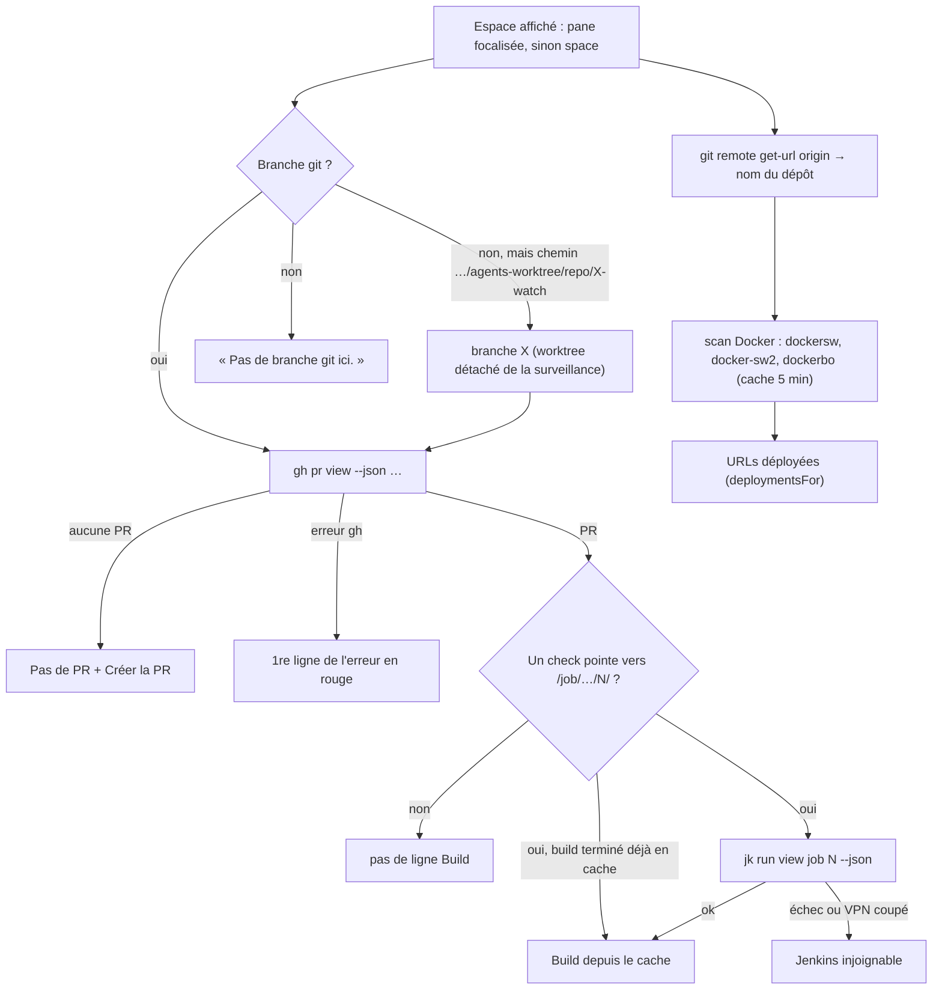
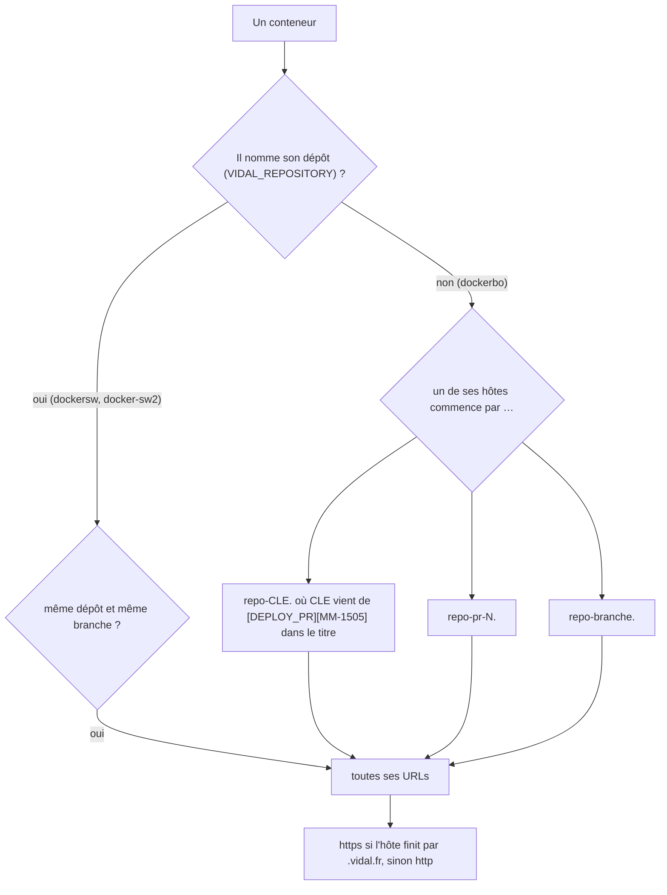

# Mod `pr` : le panneau Pull request

Notre mod (pas un clone). Il remplit le bloc `pr` du panneau latéral du layout `jc`, ouvert par le bouton PR de `tabs-jc`. Il a deux parties :

- en haut, la PR de la branche affichée, son build Jenkins, où elle est déployée et ses checks ;
- en bas, la **Surveillance** : la liste des PR que `status-jc` suit, avec l'interrupteur et le bouton pause. Le panneau ne fait que l'afficher et écrire l'interrupteur et les pauses ; toute la logique est dans [`status-jc`](../status-jc/README.md).

## Ce que tu vois

```
Pull request                                  …  Rafraîchir
────────────────────────────────────────────────────────────
Titre de la PR                      ← clic : la PR sur GitHub
#482 [Ouverte] [Revue attendue] +120 −34
┌──────────┬───────────────────────────────────────────────┐
│ Build    │ ● #57 échec          9 min  📜 🔁             │ ← clic sur la ligne : le build
│          │ 412 tests · 3 en échec · 2 ignorés           │
│ Déployée │ merlin-feat-x.dockersw.vidal.net             │ ← « nulle part » si rien, « … » pendant la recherche
│ Checks   │ ● 1 en échec · 2 ✓                        ›  │ ← clic : déplie la liste
└──────────┴───────────────────────────────────────────────┘
feat/x → master · revue demandée à alice
SURVEILLANCE …
```

- La ligne **Build** n'existe que si un check de la PR pointe vers un build Jenkins. 📜 ouvre la console, 🔁 relance (`jk run rerun`) et n'apparaît que sur un build terminé qui n'a pas réussi. Hors VPN : « Jenkins injoignable (VPN ?) ».
- **Checks** ne compte pas le check du build affiché dans Build, sauf hors VPN (Build ne connaît alors pas son résultat) ; un autre job Jenkins y reste. La ligne disparaît s'il ne reste aucun check. Dépliée ou repliée, elle le reste d'un espace à l'autre.
- Sans PR : « Pas de PR pour `<branche>` », la ligne Déployée si un conteneur a été trouvé, et le bouton **Créer la PR** (`gh pr create --web`).
- Une action (relance, création) affiche sa progression puis son erreur éventuelle en bas du panneau.

## D'où viennent les données



Chaque réponse s'affiche dès qu'elle arrive : la PR d'abord, puis le build et les déploiements.

**Quand ça se rafraîchit** : à l'ouverture du panneau, quand l'espace ou la pane affichés changent pendant qu'il est ouvert, toutes les 60 s s'il est visible, et sur « Rafraîchir » (qui relance aussi le scan Docker sans attendre ses 5 min). Panneau fermé : rien n'est appelé. En revenant sur un espace déjà vu, son dernier état s'affiche tout de suite pendant que le rafraîchissement tourne ; seule la réponse la plus récente d'un espace l'écrit.

### Trouver un déploiement

Le scan lit `VIRTUAL_HOST`, `VIDAL_REPOSITORY` et `VIDAL_GIT_REMOTE_BRANCH` de chaque conteneur (le reste de l'env n'est pas gardé : il peut contenir des secrets).



## Fichiers

| Fichier | Rôle |
|---|---|
| `main.js` | La vue : récupération (gh, jk, Docker), caches, rendu des deux parties. |
| `model.js` | Fonctions pures testées : URL Jenkins → job, checks de gh, résumé, durées, parsing Docker, correspondance des déploiements, branche d'un worktree de surveillance, cache borné. |
| `model.test.mjs` | Tests de `model.js`. |
| `mod.json` | `place: none` : le mod n'est posé que par le layout. |

Tests : `node --test ~/.config/herdr-app/mods/pr/*.test.mjs`. Vérification du mod : `herdr-app check ~/.config/herdr-app/mods/pr`.

## À savoir

- Un mod caché garde ses timers : `visible()` vérifie que le panneau est ouvert sur `pr` avant chaque appel à gh ou jk.
- Après un `await`, il faut le `cx` de la tâche (`cx.spawn`), pas celui du rendu ou du clic, qui n'est plus valide.
- Les caches (espaces vus, builds finis, dépôts) gardent 30 entrées, pour qu'un Herdr ouvert des jours ne grossisse pas.
- `model.js` n'importe rien de Herdr, sinon Node ne peut pas le tester.
- Jenkins n'a pas le plugin Pipeline Graph View : pas d'étapes, seulement résultat, tests et durée.

Designs : [aspect du panneau](../../docs/2026-11-16-pr-panel-look-design.md), [surveillance](../../docs/2026-11-14-pr-watch-design.md).
