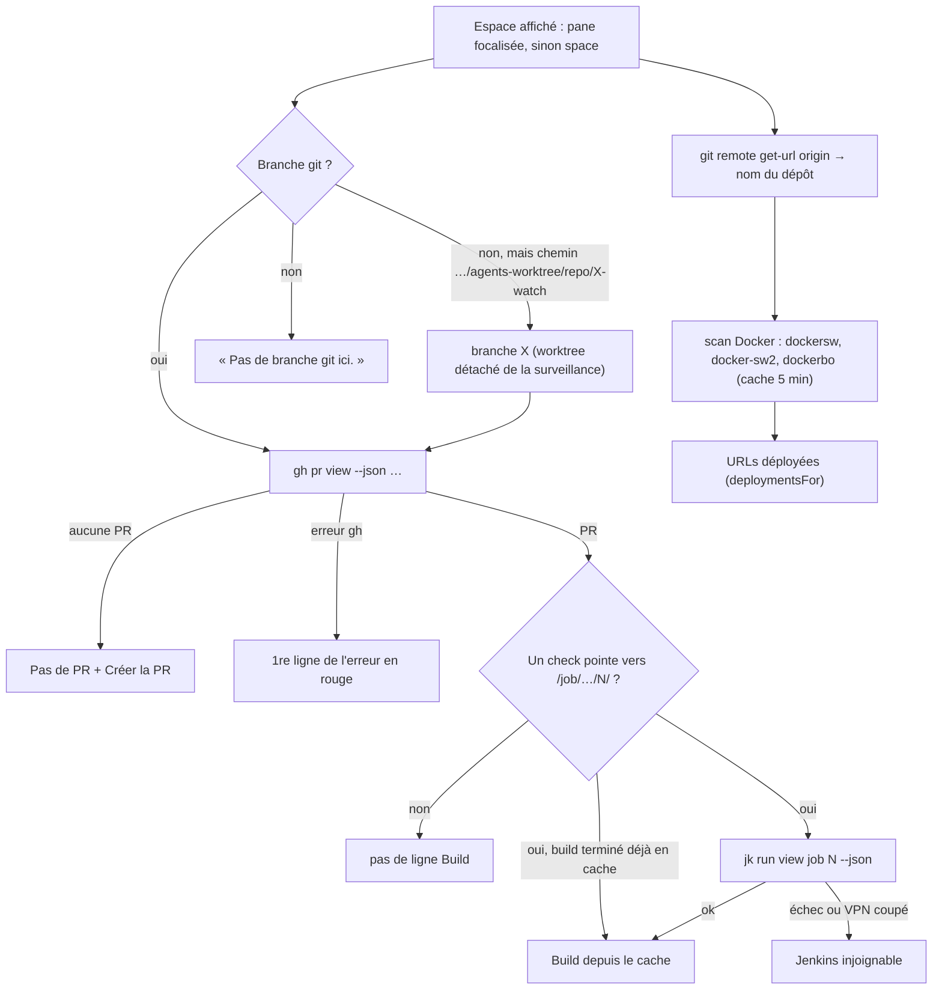
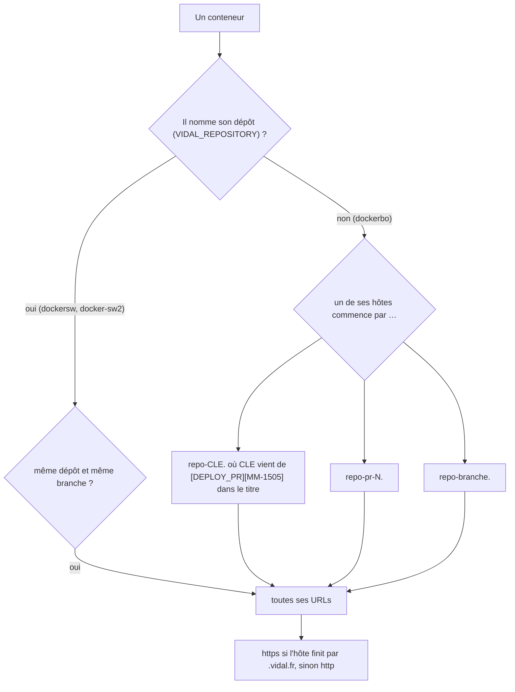

# Mod `pr` : le panneau Pull request

Notre mod (pas un clone). Il remplit le bloc `pr` du panneau latéral du layout `jc`, ouvert par le bouton PR de `tabs-jc`. Il a deux parties :

- en haut, la PR de la branche affichée, son build Jenkins, où elle est déployée et ses checks ;
- en bas, la **Surveillance** : la liste des PR que `status-jc` suit, avec l'interrupteur, le bouton ⌨ « Travailler dessus » et le bouton pause. ⌨ ouvre un espace Claude dans le worktree de la PR : celui de la branche pour un brouillon, le `-watch` pour une PR prête, qui est alors mise en pause jusqu'à la fermeture de cet espace ; « ouverture… » puis l'éventuelle erreur s'affichent sous la ligne. Le panneau ne fait que l'afficher et écrire l'interrupteur, les pauses et les demandes d'ouverture (`shared("pr-open")`) ; toute la logique est dans [`status-jc`](../status-jc/README.md).

## Ce que tu vois

```
Pull request                               …  ?  Rafraîchir
────────────────────────────────────────────────────────────
Titre de la PR                      ← clic : la PR sur GitHub
#482 [Ouverte] [Revue attendue] +120 −34
┌──────────┬───────────────────────────────────────────────┐
│ Build    │ ● #57 échec          9 min  📜 🔁             │ ← clic sur la ligne : le build
│          │ 412 tests · 3 en échec · 2 ignorés           │
│ Déployée │ merlin-feat-x.dockersw.vidal.net             │ ← « nulle part » si rien, « … » pendant la recherche
│ Checks   │ ● 1 en échec · 2 ✓                        ›  │ ← clic : déplie la liste
│ Squash   │ ● 2 commits fixup! à squasher · auto…     ⤵  │ ← PR ouverte ; « rien à squasher » sinon
│ Merge    │ armé · CI en cours                         ✕  │ ← seulement une fois armé
└──────────┴───────────────────────────────────────────────┘
[Merger quand tout est vert]          ← PR ouverte, pas brouillon, pas armée
feat/x → master · revue demandée à alice
SURVEILLANCE
● Surveillance active  Agents 2/3  karadoc libre   tour dans 1 min ↻
● arthur #5471                          ⤵ ⇥ ⌨ ⏸ [agent en cours]
  Ajoute l'export PDF des ordonnances
  [git][jenk][sonar][rev][qa][demo][risk][appr][merge]   ← la bande d'étapes
  qa depuis 12 min · prête à approuver dans ~35 min · agent qa lancé sur 1a2b3c4d
```

- **Bandeau** : l'interrupteur, les agents de surveillance occupés sur 3, l'onglet qui tient karadoc, le temps avant le prochain tour (toutes les 2 min) ; ↻ en demande un tout de suite.
- **?** dans l'en-tête déplie une aide : ce que montrent les deux parties, les neuf étapes dans l'ordre, les couleurs et les boutons. Chaque statut a aussi son infobulle.
- **Brouillons (N)** dans le bandeau masque les brouillons (en pause compris, sauf ceux « à toi », « erreur » ou « pas de clone local ») et les réaffiche ; le choix est gardé dans `shared("pr-watch-view")`, que `status-jc` ne réécrit pas.
- **Bande d'étapes**, calculée par `status-jc` : vert fait, orange clignotant en cours (agent, CI, merge armé), orange fixe en attente d'une approbation humaine, rouge en échec que la surveillance corrige, violet à toi, gris à venir, pointillé jamais fait dans ce repo (pas de CI, de Sonar, de qa ou de `## Demo`). Un brouillon n'a que git, jenk et sonar ; une PR en pause a sa bande pâlie.
- La ligne du dessous commence par l'étape en cours et sa durée, puis l'estimation « prête à approuver dans ~X » (médiane des passages précédents, rien avant 3 mesures), ou « dépend de toi ».
- **⤵** (PR avec des `fixup!`) et **⇥** (PR prête ; ✕ une fois armée) font la même chose que Squash et « Merger quand tout est vert » du haut, sans ouvrir le space. **⌨** est pâli quand son worktree n'existe pas encore, a une pastille quand un space le montre déjà.

- La ligne **Build** n'existe que si un check de la PR pointe vers un build Jenkins. 📜 ouvre la console, 🔁 relance (`jk run rerun`) et n'apparaît que sur un build terminé qui n'a pas réussi. Hors VPN : « Jenkins injoignable (VPN ?) ».
- **Checks** ne compte pas le check du build affiché dans Build, sauf hors VPN (Build ne connaît alors pas son résultat) ; un autre job Jenkins y reste. La ligne disparaît s'il ne reste aucun check. Dépliée ou repliée, elle le reste d'un espace à l'autre.
- Sans PR : « Pas de PR pour `<branche>` », la ligne Déployée si un conteneur a été trouvé, et le bouton **Créer la PR** (`gh pr create --web`).
- **Merger quand tout est vert** arme un « rebase and merge » de la PR sur son commit de tête : `status-jc` la fusionne dans la minute qui suit le passage au vert de tous ses checks, même panneau fermé (détail dans son [README](../status-jc/README.md#merge-armé)). La ligne **Merge** dit ce qu'on attend et l'erreur éventuelle de gh ; ✕ désarme. Un merge refusé par GitHub y reste affiché (« merge refusé » et l'erreur) jusqu'au ✕. Un nouveau commit ou un commit `fixup!`/`amend!`/`squash!` désarme avec un toast.
- **Squash** compte les commits `fixup!`/`amend!`/`squash!` de la PR. ⤵ demande à `status-jc` de les replier et de pousser en force (git seul, un agent seulement sur conflit) ; « squash en cours… » puis l'erreur éventuelle s'affichent sur la ligne (détail dans son [README](../status-jc/README.md#squash-à-la-demande)). Sans clic, la surveillance le fait seule une fois la PR approuvée (« auto après approbation » tant qu'elle ne l'est pas).
- Une action (relance, création) affiche sa progression puis son erreur éventuelle en bas du panneau.

## D'où viennent les données



Chaque réponse s'affiche dès qu'elle arrive : la PR d'abord, puis le build et les déploiements.

**Quand ça se rafraîchit** : à l'ouverture du panneau, quand l'espace ou la pane affichés changent pendant qu'il est ouvert, toutes les 60 s s'il est visible, et sur « Rafraîchir » (qui relance aussi le scan Docker sans attendre ses 5 min). Panneau fermé : rien n'est appelé. En revenant sur un espace déjà vu, son dernier état s'affiche tout de suite pendant que le rafraîchissement tourne ; seule la réponse la plus récente d'un espace l'écrit.

### Trouver un déploiement

Le scan lit `VIRTUAL_HOST`, `VIDAL_REPOSITORY` et `VIDAL_GIT_REMOTE_BRANCH` de chaque conteneur (le reste de l'env n'est pas gardé : il peut contenir des secrets).



## Fichiers

| Fichier | Rôle |
|---|---|
| `main.js` | La vue : récupération (gh, jk, Docker), caches, rendu des deux parties. |
| `model.js` | Fonctions pures testées : URL Jenkins → job, checks de gh, résumé, durées, parsing Docker, correspondance des déploiements, branche d'un worktree de surveillance, cache borné, et ce que montre la Surveillance (texte du temps, aspect de ⌨, boutons ⤵ et ⇥, cases de la bande, prochain tour). |
| `model.test.mjs` | Tests de `model.js`. |
| `mod.json` | `place: none` : le mod n'est posé que par le layout. |

Tests : `node --test ~/.config/herdr-app/mods/pr/*.test.mjs`. Vérification du mod : `herdr-app check ~/.config/herdr-app/mods/pr`.

## À savoir

- Un mod caché garde ses timers : `visible()` vérifie que le panneau est ouvert sur `pr` avant chaque appel à gh ou jk.
- Après un `await`, il faut le `cx` de la tâche (`cx.spawn`), pas celui du rendu ou du clic, qui n'est plus valide.
- Les caches (espaces vus, builds finis, dépôts) gardent 30 entrées, pour qu'un Herdr ouvert des jours ne grossisse pas.
- `model.js` n'importe rien de Herdr, sinon Node ne peut pas le tester.
- Jenkins n'a pas le plugin Pipeline Graph View : pas d'étapes, seulement résultat, tests et durée.

Designs : [bande d'étapes](../../docs/2026-11-20-pr-watch-pipeline-design.md), [brouillons masqués](../../docs/2026-11-20-pr-watch-drafts-filter-design.md), [aspect du panneau](../../docs/2026-11-16-pr-panel-look-design.md), [surveillance](../../docs/2026-11-14-pr-watch-design.md), [merge armé](../../docs/2026-11-17-pr-armed-merge-design.md).
