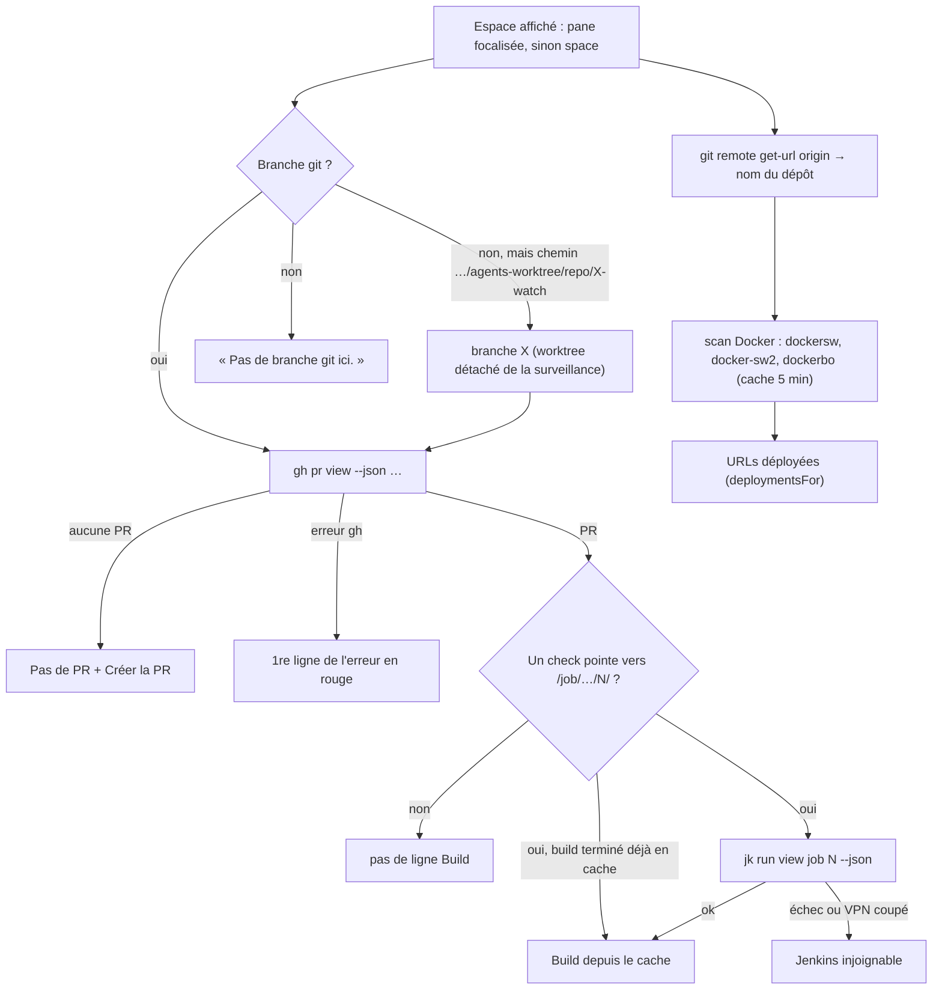
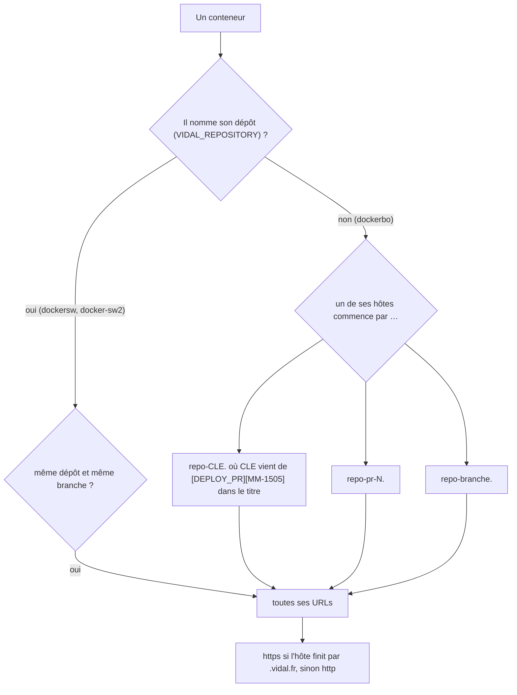

# Mod `pr` : le panneau Pull request

Notre mod (pas un clone). Il remplit trois blocs du panneau latéral du layout `jc`, choisis par sa prop `view` :

- `pr` (bouton Pull request de `tabs-jc`, `⌘⇧R`) : la PR de la branche affichée, son build Jenkins, où elle est déployée et ses checks ;
- `watch` (`view: watch`, bouton Surveillance des PR, `⌘⇧U`) : la **Surveillance**, la liste des PR que `status-jc` suit, avec l'interrupteur, le bouton ⌨ « Travailler dessus » et le bouton pause. ⌨ ouvre un espace Claude dans le worktree de la PR : celui de la branche pour un brouillon, le `-watch` pour une PR prête, qui est alors mise en pause jusqu'à la fermeture de cet espace ; « ouverture… » puis l'éventuelle erreur s'affichent sous la ligne. Le panneau ne fait que l'afficher et écrire l'interrupteur, les pauses et les demandes d'ouverture (`shared("pr-open")`) ; toute la logique est dans [`status-jc`](../status-jc/README.md).

- `ci` (`view: ci`, bouton CI, `⌘⇧I`) : le dernier build Jenkins des branches longues des dépôts où j'ai contribué, avec **Corriger** (voir [plus bas](#ci-des-branches-longues-view-ci)).

## Ce que tu vois

```
Pull request                                  …  Rafraîchir
────────────────────────────────────────────────────────────
Titre de la PR                      ← clic : la PR sur GitHub
#482 [Ouverte] [Revue attendue] +120 −34
┌──────────┬───────────────────────────────────────────────┐
│ Build    │ ● #57 échec          9 min  [log] [relance]   │ ← clic sur la ligne : le build
│          │ 412 tests · 3 en échec · 2 ignorés           │
│ Déployée │ merlin-feat-x.dockersw.vidal.net             │ ← « nulle part » si rien, « … » pendant la recherche
│ Checks   │ ● 1 en échec · 2 ✓                        ›  │ ← clic : déplie la liste
│ Squash   │ ● 2 commits fixup! à squasher · merge… Squasher│ ← PR ouverte ; « rien à squasher » sinon
│ Merge    │ armé · CI en cours                  Désarmer  │ ← seulement une fois armé
└──────────┴───────────────────────────────────────────────┘
[Prête pour review]                   ← brouillon ouvert : gh pr ready
[Merger quand tout est vert]          ← PR ouverte, pas brouillon, pas armée, sans fixup!
feat/x → master · revue demandée à alice
```

```
Surveillance des PR               tour dans 1 min  [rafraîchir]  ?
────────────────────────────────────────────────────────────
● Surveillance active  − Agents 2/3 +  karadoc libre
arthur #5471                         [terminal] [pause] [agent en cours]
  Ajoute l'export PDF des ordonnances
  [git][jenk][sonar][rev][qa][demo][risk][appr][merge]   ← la bande d'étapes
  qa depuis 12 min · prête à approuver dans ~35 min · agent qa lancé sur 1a2b3c4d
  Squasher 2 fixup!                                      ← les actions qui s'appliquent
ordostruct #74                       [terminal] [pause] [ok]   ← une PR ok se replie : nom et bande
  [git][jenk][sonar][rev][qa][demo][risk][appr][merge]
```

- **En-tête** de la Surveillance : le temps avant le prochain tour (toutes les 2 min) ; le bouton rafraîchir en demande un tout de suite. C'est son seul rafraîchissement : elle ne fait que lire le registre de `status-jc`, sans appel gh. **Rafraîchir**, dans l'en-tête de Pull request, relit la PR de la branche.
- **Bandeau** : l'interrupteur, les agents de surveillance occupés sur leur maximum (3 par défaut, de 1 à 9 avec − et +), l'onglet qui tient karadoc.
- **?** dans l'en-tête de la Surveillance déplie une aide : les neuf étapes dans l'ordre, les couleurs, les boutons et le clavier. Chaque statut a aussi son infobulle.
- **Brouillons (N)** dans le bandeau masque les brouillons (il devient « Brouillons masqués (N) ») (en pause compris, sauf ceux « à toi », « erreur » ou « pas de clone local ») et les réaffiche ; le choix est gardé dans `shared("pr-watch-view")`, que `status-jc` ne réécrit pas.
- **Bande d'étapes**, calculée par `status-jc` : vert fait, orange clignotant en cours (agent, CI, merge armé), orange fixe en attente d'une approbation humaine, rouge en échec que la surveillance corrige, violet à toi, gris à venir, pointillé jamais fait dans ce repo (pas de CI, de Sonar, de qa ou de `## Demo`). Un brouillon n'a que git, jenk et sonar ; une PR en pause a sa bande en contours (les étapes faites gardent leur teinte, rien ne clignote). Un clic sur une case d'agent (git, jenk, sonar, rev, qa, demo, risk) rouvre sa dernière session Claude : l'onglet `⟳` tant que l'agent tourne, sinon un onglet `↺ #N <étape>` qui lance `claude --resume` dans le worktree où il a tourné (`status-jc` lance chaque agent avec `--session-id` et garde l'id dans `entry.sessions`).
- **Clavier** : ouvert par `⌘⇧U`, le bouton ou « N PR à toi » de la barre d'état (chacun écrit `shared("watch-focus")`), ou après un clic dans le panneau, la liste prend le clavier, et le cadre du panneau passe en couleur d'accent. ↑/↓ choisit une PR (cadre en couleur d'accent), Entrée va à son agent ou ouvre la PR, `p` la met en pause ou la reprend, `t` ouvre son worktree, Échap rend le clavier au terminal affiché (`pane.focus`). Aucune PR n'est choisie avant une flèche : Entrée, `p` et `t` ne font rien tant qu'une flèche n'a pas désigné une ligne, et une flèche replie l'aide pour que la ligne reste visible. Fermer le panneau pendant qu'il a le clavier le rend aussi au terminal. Un panneau rouvert par un changement de space ne prend pas le clavier. La ligne choisie ne défile pas toute seule dans la vue.
- Une PR **à toi** abandonnée sur Jenkins ou Sonar ouvre au clic ce qui bloque (la console du build, ou l'analyse Sonar : `entry.blocker`, publié par `status-jc`), avec le verbe « Ouvrir le log Jenkins » ou « Ouvrir l'analyse Sonar » sous la ligne. Son numéro ouvre toujours la PR. Sans blocage connu (conflit, worktree occupé…), le clic reste l'agent ou la PR.
- Une PR **ok** se replie sur son nom et sa bande : son titre passe en infobulle, son explication disparaît. Tout revient dès que son étiquette change. Le statut est porté par la puce seule (plus de point à gauche), et l'explication d'une PR « à toi » ne répète plus « dépend de toi ».
- La ligne du dessous commence par l'étape en cours et sa durée, puis l'estimation « prête à approuver dans ~X » (médiane des passages précédents, rien avant 3 mesures), ou « dépend de toi ».
- **Actions**, en toutes lettres sous la ligne, seulement quand elles s'appliquent : **Passer prête pour review** (brouillon : `gh pr ready`, comme le bouton **Prête pour review** de Pull request, puis un tour : ses reviews partent sans attendre les 2 min), **Squasher N fixup!** (à tout moment, brouillon compris, comme le panneau Pull request ; sans clic, la surveillance attend l'approbation ; un premier clic la change en « Confirmer le push forcé » pendant 4 s, un second la lance), **Merger quand tout est vert**, **Désarmer le merge**, ou **Effacer le refus du merge** sous l'erreur de GitHub.
- Les icônes à droite du nom : **terminal** (« Travailler dessus », voir plus haut) et **pause / lecture**. Le terminal est pâli quand son worktree n'existe pas encore, a une pastille quand un space le montre déjà.

- La ligne **Build** n'existe que si un check de la PR pointe vers un build Jenkins. l'icône de document ouvre la console, la flèche circulaire relance (`jk run rerun`) et n'apparaît que sur un build terminé qui n'a pas réussi. Hors VPN : « Jenkins injoignable (VPN ?) ».
- **Checks** ne compte pas le check du build affiché dans Build, sauf hors VPN (Build ne connaît alors pas son résultat) ; un autre job Jenkins y reste. La ligne disparaît s'il ne reste aucun check. Dépliée ou repliée, elle le reste d'un espace à l'autre.
- Sans PR : « Pas de PR pour `<branche>` », la ligne Déployée si un conteneur a été trouvé, et le bouton **Créer la PR** (`gh pr create --web`).
- **Merger quand tout est vert** arme un « rebase and merge » de la PR sur son commit de tête : `status-jc` la fusionne dans la minute qui suit le passage au vert de tous ses checks, même panneau fermé (détail dans son [README](../status-jc/README.md#merge-armé)). La ligne **Merge** dit ce qu'on attend et l'erreur éventuelle de gh ; **Désarmer** le désarme. Un merge refusé par GitHub y reste affiché (« merge refusé » et l'erreur) jusqu'à **Effacer**. Un nouveau commit ou un commit `fixup!`/`amend!`/`squash!` désarme avec un toast ; le bouton ne s'affiche donc pas tant que la PR en a, et la ligne Squash le dit (« merge après le squash »).
- **Squash** compte les commits `fixup!`/`amend!`/`squash!` de la PR. **Squasher** (confirmé par un second clic dans les 4 s) demande à `status-jc` de les replier et de pousser en force (git seul, un agent seulement sur conflit) ; « squash demandé… » tant que `status-jc` ne l'a pas pris, « squash en cours… », « conflit : un agent squash le résout… » tant que l'agent d'un conflit travaille (un clic dessus va à son onglet ; le bouton revient une fois l'onglet fermé, Claude quitté ou son travail fini), puis l'erreur éventuelle s'affichent sur la ligne, et sous la PR dans la Surveillance (détail dans son [README](../status-jc/README.md#squash-à-la-demande)). Sans clic, la surveillance le fait seule une fois la PR approuvée, ou sans approbation quand le verdict `pr-risk` sur son code demande 0 revue humaine (« auto après approbation » tant qu'elle ne l'est pas).
- Une action (relance, création) affiche sa progression puis son erreur éventuelle en bas du panneau.

## D'où viennent les données



Chaque réponse s'affiche dès qu'elle arrive : la PR d'abord, puis le build et les déploiements.

**Quand ça se rafraîchit** : à l'ouverture du panneau, quand l'espace ou la pane affichés changent pendant qu'il est ouvert, toutes les 60 s s'il est visible, et sur « Rafraîchir » (qui relance aussi le scan Docker sans attendre ses 5 min). Panneau fermé : rien n'est appelé. En revenant sur un espace déjà vu, son dernier état s'affiche tout de suite pendant que le rafraîchissement tourne ; seule la réponse la plus récente d'un espace l'écrit.

### Trouver un déploiement

Le scan lit `VIRTUAL_HOST`, `VIDAL_REPOSITORY` et `VIDAL_GIT_REMOTE_BRANCH` de chaque conteneur (le reste de l'env n'est pas gardé : il peut contenir des secrets).



## CI des branches longues (`view: ci`)

Bouton CI de `tabs-jc` (icône de branche cochée), `⌘⇧I`. Le dernier build Jenkins de chaque branche longue (`main`, `master`, `develop`, `sprint-*`, `release/*`) des dépôts `softwarevidal` où j'ai contribué ces 7 derniers jours, que la casse vienne de moi ou d'un autre.

```
CI des branches longues                 il y a 0 min  rafraîchir
────────────────────────────────────────────────────────────
arthur
  ● master        #2781 échec   il y a 4 h 16   [log] [relance] Corriger
  ● sprint-roger  #2398 échec   il y a 3 h 26   [log] [relance] fix en cours → #5520
docker-lib-karadoc
  ● master          #122 ok     il y a 76 h 29
```

- Groupé par dépôt, ceux qui ont une branche rouge en tête. Pastille verte ok, rouge échec / instable / abandonné, orange clignotante en cours. Un clic sur la ligne ouvre le build.
- Sur un build rouge terminé : la console, la relance (`jk run rerun`) et **Corriger**, ou « fix en cours » quand une PR ouverte part d'une branche `fix/ci-<branche>-<N>` (clic : la PR) ou que le worktree du fix de ce build existe.
- « Aucune contribution de toi depuis 7 jours », « Jenkins injoignable (VPN ?) » quand tous les appels `jk` échouent ; un dépôt sans dossier Jenkins disparaît simplement.

**Données** : les dépôts sont l'union de `gh search prs --author=@me --merged-at` (mes PR mergées, toutes branches cibles) et `gh search commits --author=@me` (la branche par défaut, pushs directs compris), limités à `softwarevidal` ; leurs jobs viennent de `jk job ls team.software/github/<repo>` (le nom brut, `release%2Fv4` : `jk` répond 404 à `release/v4`) ; le dernier build de `jk run ls <job> --limit 1`. Dépôts et jobs sont gardés 15 min, les builds relus à chaque tour : à l'ouverture, toutes les 60 s panneau visible, et sur « rafraîchir » (qui relit aussi les dépôts). Panneau fermé : aucun appel.

Design : [CI des branches longues](../../docs/2026-11-24-ci-watch-design.md).

## Fichiers

| Fichier | Rôle |
|---|---|
| `main.js` | La vue : récupération (gh, jk, Docker), caches, rendu des deux parties. |
| `model.js` | Fonctions pures testées : URL Jenkins → job, checks de gh, résumé, durées, parsing Docker, correspondance des déploiements, branche d'un worktree de surveillance, cache borné, et ce que montre la Surveillance (texte du temps, aspect de ⌨, actions Squasher et Merger, cases de la bande, prochain tour). |
| `model.test.mjs` | Tests de `model.js`. |
| `ci.js` | La vue CI : récupération (gh, jk), cache des dépôts et jobs, rendu, relance et Corriger. |
| `ci-model.js` | Fonctions pures de la vue CI : branches longues, lecture des réponses gh / jk, état d'une ligne, fix en cours, tri, consigne de l'agent. |
| `ci-model.test.mjs` | Tests de `ci-model.js`. |
| `mod.json` | `place: none` : le mod n'est posé que par le layout. |

Tests : `node --test ~/.config/herdr-app/mods/pr/*.test.mjs`. Vérification du mod : `herdr-app check ~/.config/herdr-app/mods/pr`.

## À savoir

- Un mod caché garde ses timers : `visible()` vérifie que le panneau est ouvert sur le bloc de cette copie avant chaque appel à gh ou jk, et la copie `watch` n'en fait jamais.
- Deux copies du mod tournent (`pr` et `watch`) : chacune a ses caches, la seconde ne s'en sert pas.
- Après un `await`, il faut le `cx` de la tâche (`cx.spawn`), pas celui du rendu ou du clic, qui n'est plus valide.
- Les caches (espaces vus, builds finis, dépôts) gardent 30 entrées, pour qu'un Herdr ouvert des jours ne grossisse pas.
- `model.js` n'importe rien de Herdr, sinon Node ne peut pas le tester.
- Jenkins n'a pas le plugin Pipeline Graph View : pas d'étapes, seulement résultat, tests et durée.

Designs : [bande d'étapes](../../docs/2026-11-20-pr-watch-pipeline-design.md), [brouillons masqués](../../docs/2026-11-20-pr-watch-drafts-filter-design.md), [aspect du panneau](../../docs/2026-11-16-pr-panel-look-design.md), [surveillance](../../docs/2026-11-14-pr-watch-design.md), [merge armé](../../docs/2026-11-17-pr-armed-merge-design.md).
