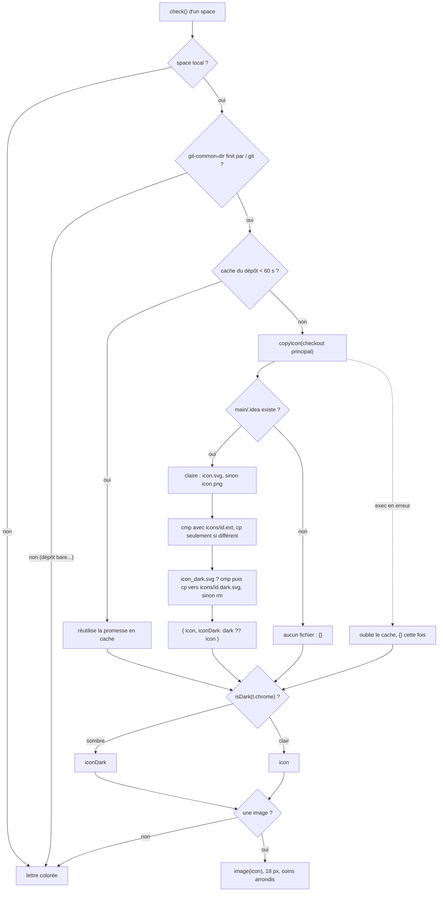

# spaces-jc

Clone du mod `spaces` de Herdr (version 0.1.16, voir `cloned_from` dans `mod.json`). C'est la liste des spaces en haut de la sidebar.

## Ce que le clone ajoute

Une seule chose : l'avatar d'un space devient l'icône JetBrains du dépôt (`.idea/icon.svg`, `icon.png`, `icon_dark.svg`) au lieu de la lettre colorée.

- Tous les worktrees d'un dépôt prennent l'icône du checkout principal : pas besoin de `.idea` dans chaque worktree.
- Sur un thème sombre, `icon_dark.svg` s'il existe, sinon l'icône claire.
- Sans icône, la lettre colorée d'origine reste.
- Seuls les spaces locaux ont une icône : un space sur une autre machine garde sa lettre.
- Les lignes de worktree rangées sous leur dépôt (`├─`, `└─`) n'ont pas d'avatar, icône ou pas : elles montrent le glyphe de branche, comme l'original.
- Une icône ajoutée ou changée apparaît au prochain passage git du space une fois le cache d'une minute expiré. En pratique entre une et deux minutes, et seulement quand la fenêtre est active (à vérifier : le rythme exact dépend du `FALLBACK` de 60 s et des autres déclencheurs du mod).

## Comment l'avatar est choisi

`check()` lance déjà `git rev-parse --git-common-dir` pour chaque space. Quand le résultat finit par `/.git`, le dossier parent est le checkout principal, et `iconOf()` cherche l'icône là.

Quelques détails :

- `<id>` est le chemin du checkout avec chaque suite de caractères non alphanumériques remplacée par `_` (`/Volumes/sourcecode/arthur` donne `_Volumes_sourcecode_arthur`).
- Le script `sh` supprime l'ancienne extension quand une icône passe de png à svg (ou l'inverse), et le `.dark.svg` quand `icon_dark.svg` disparaît.
- `isDark()` calcule la luminance de `t.chrome`, la couleur sous l'avatar. Il ne lit que `#rgb` ou `#rrggbb` : une autre forme de couleur serait vue comme claire.

## Maintenance du clone

Herdr ne met jamais à jour un clone. L'original `mods/spaces/` est committé à côté : c'est la base de fusion. `herdr-upstream`, lancé par `dot`, fusionne dans `main.js` ce que Herdr a changé dans l'original depuis le dernier commit.

En cas de `main.js.conflict` : reporter à la main les changements dans `main.js`, supprimer le `.conflict`, `herdr-app check ~/.config/herdr-app/mods/spaces-jc`, puis committer le clone et le nouvel original ensemble. Détails dans `~/.config/CLAUDE.md`, section « Herdr desktop app ».

## Fichiers

| Fichier | Rôle |
|---|---|
| `main.js` | Le mod, original + `isDark`, `iconOf`, `copyIcon` |
| `mod.json` | `cloned_from` : ce que `herdr-upstream` lit pour trouver l'original |
| `icons/` | Copies des icônes, écrites par le mod. Pas committé |
| `gpui-kit.d.ts`, `jsconfig.json` | Écrits par Herdr, ne pas committer |

## Pièges

- `image()` ne lit que sous `~/.config/herdr-app` (`appHome()`) : d'où la copie dans `icons/` au lieu de pointer vers le `.idea` du dépôt.
- Écrire un fichier dans le dossier du mod recharge le mod et relance `init()`, qui vide le cache. Le script ne copie donc que si le contenu diffère (`cmp -s`) : sinon chaque copie déclencherait un rechargement, puis une nouvelle copie, en boucle.
- Pour la même raison, ne rien créer d'autre dans ce dossier pendant que Herdr tourne sans s'attendre à un rechargement.
- `icons/` n'est ignoré par yadm que par accident : le motif `Icon?` de `~/.gitignore_global` (pensé pour les fichiers `Icon\r` de macOS) l'attrape parce que git ignore la casse sur macOS.
- Deux checkouts dont les chemins ne diffèrent que par la ponctuation (`a-b` et `a_b`) partagent le même `<id>`, donc la même icône.
- Un dépôt avec seulement `icon_dark.svg` n'a pas d'icône sur un thème clair : la lettre s'affiche.
