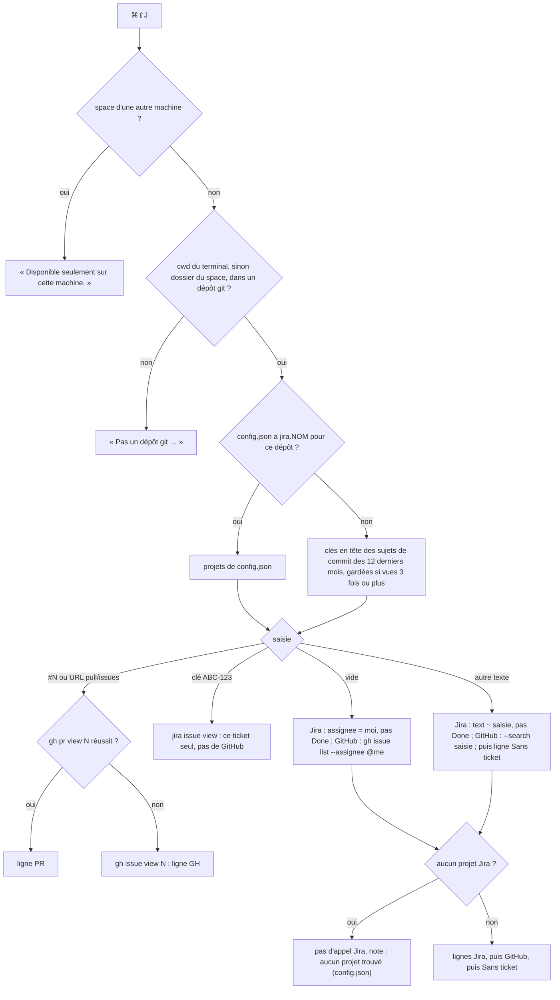
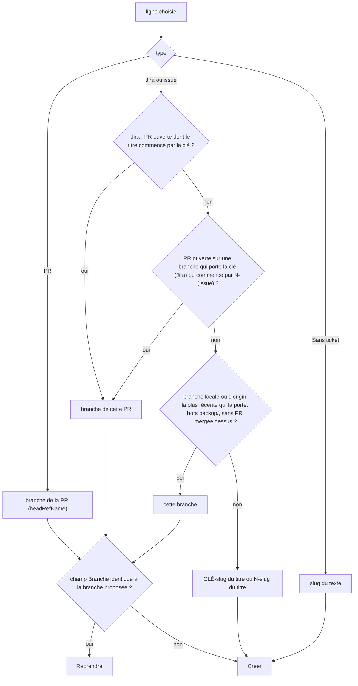
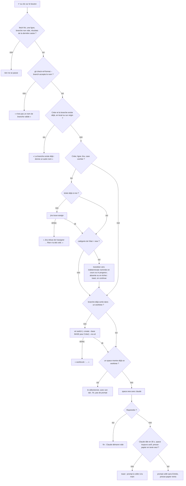

# start-work (`⌘⇧J`)

Notre mod (pas un clone de Herdr) pour commencer un ticket en un geste : un ticket Jira, une issue GitHub ou un travail sans ticket part dans un nouveau worktree avec Claude, et une PR se reprend sur sa propre branche. Le raccourci est dans `keys.json` : `"cmd-shift-j": "mod.open:start-work"`.

## 1. Ce que ça fait

Depuis un terminal dans un dépôt, tu choisis un ticket. Le mod :

1. t'assigne le ticket Jira et le passe En cours s'il était encore « à faire » (case à décocher) ;
2. crée le worktree avec worktrunk (`wt switch --create`), depuis la base choisie ;
3. ouvre un space Herdr dessus avec `claude` ;
4. colle dans Claude `/superpowers:brainstorming <ticket>` **sans l'envoyer**, pour que tu le complètes.

Si le ticket a déjà une branche ou une PR ouverte, le bouton devient **Reprendre** : pas de Jira, pas de prompt, juste le worktree (sorti au besoin) et un space dessus, ou le space déjà ouvert.

## 2. Utilisation

La fenêtre prend le dépôt du terminal actif (sinon le dossier du space). Elle refuse un space d'une autre machine et un dossier hors git.

Ce que tu peux taper :

| Saisie | Résultat |
|---|---|
| rien | mes tickets Jira pas Done des projets du dépôt, puis mes issues GitHub ouvertes, 20 de chaque au plus |
| `MERLIN-2321` (casse ignorée) | ce ticket, quel que soit son projet ou son état |
| `#5471`, ou l'URL `https://github.com/…/pull/5471` ou `…/issues/5471` | la PR n°5471 si elle existe, sinon l'issue |
| autre texte | recherche Jira (`text ~`, tickets pas Done des projets du dépôt) et GitHub (issues ouvertes, `--search`), 20 de chaque au plus, puis une ligne « Sans ticket : <texte> » |

Sous la liste : la **base** (la branche par défaut d'`origin/HEAD`, puis jusqu'à 4 `sprint-*` d'origin, les plus récentes d'abord ; clic pour choisir) et la **branche**, pré-remplie et modifiable. Un nom tapé à la main reste tant que tu ne changes pas de ligne. Sur une ligne PR, le champ est ignoré : une PR se reprend toujours sur sa propre branche.

Touches : `↑` `↓` choisissent (la liste boucle), `↵` dans l'un ou l'autre champ crée ou reprend, `esc` ferme. Un clic sur une ligne la choisit. Une ligne montre sa source (`JIRA`, `GH`, `PR`), son numéro et son titre ; pour Jira, en plus, l'assigné s'il n'est pas toi et l'état.

La recherche part 300 ms après la dernière frappe ; une réponse plus ancienne est jetée. Une ligne d'erreur rouge par source qui a échoué (`Jira : …`, `GitHub : …`) s'affiche sous le champ. En haut : le nom du dépôt, et à droite les projets Jira retenus pour lui.

## 3. Comment une saisie est résolue

### Le dépôt et la liste



### La branche proposée et le bouton



Le slug : sans accents ni emoji, minuscules, tirets, 50 caractères au plus coupés à un tiret. « Porte la clé » veut dire `MERLIN-2321` en début de nom ou après un `/`, sans chiffre derrière (casse ignorée) ; pour une issue, `5355-` en début de nom ou après un `/`.

### Après `↵`



Le prompt : Jira `/superpowers:brainstorming MERLIN-2321 : <titre>`, issue `/superpowers:brainstorming <url> : <titre>`, sans ticket `/superpowers:brainstorming <texte>`. Les avertissements (état Jira inchangé, prompt à coller, presse-papier pas remis) arrivent en toasts d'une minute.

Le worktree va où worktrunk le met (d'après la conception : `~/dev/agents-worktree/<repo>/<branche>`) ; ses hooks de création tournent.

## 4. Configuration

Facultative. `~/.config/herdr-app/mods/start-work/config.json` remplace la détection des projets Jira pour un dépôt, désigné par le nom du dossier de son checkout principal. Un nom seul ou une liste :

```json
{
  "jira": {
    "arthur": ["MERLIN", "APIREST"],
    "autre-depot": "ZAPI"
  }
}
```

Fichier absent ou JSON invalide : ignoré sans message, on retombe sur les sujets de commit.

## 5. Fichiers, tests, pièges

| Fichier | Rôle |
|---|---|
| `mod.json` | dialogue modal 680 × 480, titre « Commencer un travail » |
| `main.js` | la fenêtre : dépôt, chargement (fetch, branches, PR), recherche, choix de la ligne et de la branche |
| `work.js` | les effets, dans l'ordre : Jira, worktree, space, collage du prompt |
| `lib.js` | la logique pure, sans import Herdr : slug, nom de branche, analyse de la saisie, projets, JQL, `existingWork`, transition, `spaceIn`, presse-papier |
| `lib.test.mjs` | les tests de `lib.js` |
| `config.json` | facultatif, voir §4 |

```sh
node --test ~/.config/herdr-app/mods/start-work/*.test.mjs
```

Seul `lib.js` est testé ; `main.js` et `work.js` se vérifient à la main dans Herdr (`herdr-app check ~/.config/herdr-app/mods/start-work`).

À savoir :

- Un texte qui a la forme d'une clé (`covid-19`) est lu comme une clé Jira : pas de ligne « Sans ticket », et une erreur Jira si le ticket n'existe pas. Ajoute un mot.
- Une URL GitHub collée est lue dans le dépôt courant, quel que soit le dépôt qu'elle nomme.
- Une PR venant d'un fork ne se reprend pas : sa branche n'est pas sur `origin`, worktrunk échoue.
- « Livré » veut dire : une PR mergée sur cette branche (parmi les 200 dernières). Pas `git branch --merged`, qui compte aussi une branche toute neuve sans commit. Une branche livrée est ignorée et le ticket repart sur une branche neuve ; si son nom existe encore, en local ou sur origin, Créer refuse : renomme.
- Pour ouvrir un second chantier sur un ticket déjà en cours, change le nom de branche : le bouton repasse à Créer, avec Jira et le prompt.
- Le bouton ne peut rien tant que le `git fetch origin` n'est pas fini (grisé ; « Chargement… » tant que la liste est vide), pour ne jamais partir d'un vieux `origin/<base>`. Il est aussi grisé si la branche est vide ou si la recherche en cours n'a pas répondu.
- Fermer la fenêtre pendant la création (Herdr ferme même sur `esc`) coupe le travail : un toast dit l'étape, ce qui est fait reste fait (ticket assigné, worktree).
- Jira passe par `fish -c` pour avoir `JIRA_API_TOKEN` (`conf.d/secrets.fish`) ; mon adresse Jira est en dur dans `work.js` (`ME`).
- Le collage exporte `LANG=en_US.UTF-8` : Herdr lance les programmes sans locale, et `pbcopy` lirait les accents en MacRoman.
- Si le presse-papier ne peut pas être remis, il reste sauvé dans le fichier temporaire que le toast nomme.

## 6. Conception

[`../../docs/2026-11-13-start-work-design.md`](../../docs/2026-11-13-start-work-design.md). Elle date d'avant certains choix : le code fait foi (voir les écarts ci-dessous).

Écarts connus avec la conception :

- les PR (`#N`, URL) sont gérées, alors qu'elles y sont un non-objectif ;
- « livré » ne regarde que les PR mergées, pas `git merge-base --is-ancestor` ;
- l'assignation vise une adresse en dur, pas `$(jira me)` ;
- `tab` pour passer au champ Branche n'est pas géré par le mod (à vérifier : peut-être fait par Herdr).
