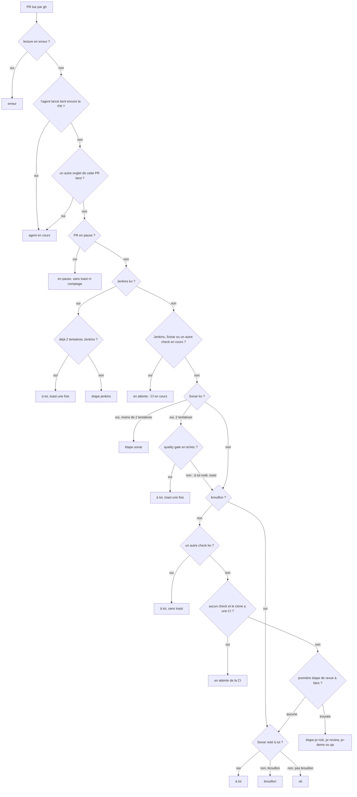
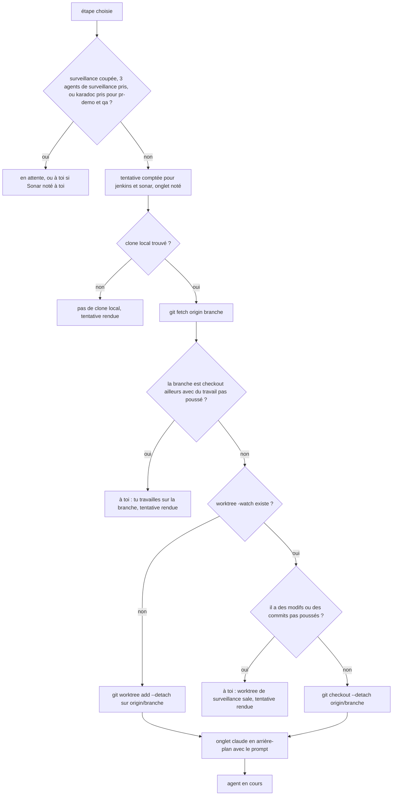

# status-jc

Clone perso du mod `workspace-status` de Herdr (version 0.1.15, voir `mod.json`), la barre d'état en bas du layout `jc`.

## Ce que fait le mod

Il affiche la barre d'état : machine, branche, nombre d'agents et combien t'attendent, puis les ports ouverts par les programmes du space affiché, et le raccourci de la palette. Il héberge aussi la surveillance des PR : toutes les 5 minutes, il lit tes PR ouvertes et lance des agents Claude dans des onglets visibles pour réparer Jenkins ou Sonar, puis pour la revue. Le panneau PR (`mods/pr/`) n'en est que l'affichage et l'interrupteur.

## Barre d'état

De gauche à droite :

- `This computer` (ou le nom de la machine pour un space distant), la branche du space ;
- `N agents`, et `· N needs you` pour les agents `blocked`. Ce nombre part aussi en pastille sur l'icône du Dock (`setBadge`, rappelé seulement quand il change) ;
- les ports du space affiché, triés : point vert plein = répond, cercle qui clignote = démarre. Un clic ouvre `http://localhost:<port>/` ;
- le raccourci de la palette tel qu'il est vraiment lié dans `keys.json` (`commands` seul s'il n'y en a pas). Un clic l'ouvre.

Les icônes viennent de `mods/workspace-chrome/*.svg` (mod livré par Herdr).

Les ports sont relus toutes les 5 s, et tout de suite quand tu changes de space :

1. `lsof -nP -iTCP -sTCP:LISTEN -Fpn` donne les process qui écoutent et leurs ports. Les ports à partir de 32768 (éphémères : démons, aides d'IDE) sont ignorés.
2. `ps -axo pid=,ppid=` et `lsof -a -d cwd` donnent les parents et le dossier courant de chaque process. Ces deux réponses sont réutilisées tant qu'aucun nouveau listener n'apparaît, pendant une minute au plus.
3. Le space d'un listener : le premier terminal Herdr parmi ses ancêtres (`npm run dev` lancé dans un tab). Sinon, le space dont un pane a pour dossier le plus profond qui contient son dossier courant (un JVM lancé par le démon Gradle n'est pas un descendant, mais tourne dans le worktree). Les spaces distants et les panes ouverts sur `~` ne comptent pas.
4. Seuls les ports du space affiché sont interrogés par `curl -m 2 http://127.0.0.1:<port>/` : un port inconnu ou pas encore `up` à chaque tour, un port `up` toutes les 30 s.
5. `up` si le code HTTP est entre 1 et 499, ou si curl sort en 52/56 (réponse vide ou coupée : une base de données, pas du HTTP, mais le port est ouvert). Tout le reste (500+, refus, timeout) : `starting`.

## Surveillance des PR

### Quand et quoi

Un premier tour 60 s après le démarrage du mod, puis toutes les 5 min. Les tours tournent aussi surveillance coupée : le panneau reste à jour, mais aucun agent ne part.

Un tour prend un bail `shared("pr-watch-lease")` : si une autre copie du mod en tient un de moins de 4 min, le tour ne fait rien. Il lit ensuite :

- `gh search prs --author=@me --state=open --owner=softwarevidal --updated=>=<aujourd'hui - 7 j>` : une PR sans activité depuis 7 jours sort de la liste (et du panneau) ;
- pour chaque PR, `gh pr view --json ...` (checks, commentaires, reviews) et `gh api .../commits/<sha>/check-runs` (Sonar) ;
- pour chaque dépôt, son clone local (dossiers des spaces locaux et de leurs panes, `~/dev/agents-worktree/<repo>/*`, `/Volumes/sourcecode/<repo>`, reconnu par son remote `origin`), s'il a une CI (`Jenkinsfile` ou `.github/workflows/` dans le checkout principal) et le skill QA (`testing-api-pull-requests` dont `references/report.md` porte le marqueur, sous `.agents/` ou `.claude/`).

Jenkins = un check dont l'URL est un build Jenkins (un contexte `ko` l'emporte s'il y en a plusieurs). Sonar = le check-run `SonarCloud Code Analysis` ou `SonarQube Code Analysis` : `ko` si sa conclusion est `failure` ou si son résumé annonce au moins une nouvelle issue ou un hotspot. Un check Jenkins ou Sonar déjà vu sur un ancien commit et absent du nouveau compte comme « en cours ». Les marqueurs (`<!-- pr-risk -->`, `<!-- pr-review -->`, `<!-- pr-demo -->`, `<!-- testing-api-pull-requests -->`) ne comptent qu'en tête de tes propres commentaires ou reviews.

### Décision pour une PR

`decide()` dans `watch.js`. Les tentatives Jenkins et Sonar repartent à 0 quand le check est vert ou quand un nouveau commit arrive sans qu'un onglet d'agent correcteur de la PR (jenkins, sonar, pr-review) soit ouvert : c'est ton push. Un commit apparu pendant que cet onglet existe est celui de l'agent, le budget reste.



L'étape de revue est la première, dans l'ordre `pr-risk`, `pr-review`, `pr-demo`, `qa`, qui n'a pas son marqueur sur la PR et n'a pas été fermée sans commentaire sur ce commit. `qa` seulement si le clone a le skill avec son marqueur. Un brouillon n'a jamais de revue, même avec un check en échec : il reste « brouillon ».

« L'agent lancé tient encore » : une étape de correction (jenkins, sonar) tant que son agent est `working` ou `blocked` ; `pr-review` tant que son onglet existe (il pose son marqueur avant de corriger) ; les autres étapes de revue tant que leur onglet existe sans leur marqueur. Une étape de revue dont l'onglet est fermé sans marqueur est notée « fermée sans commentaire » pour ce commit : elle ne repart pas, la suivante peut partir, et un nouveau commit la relance.

### Lancement d'une étape



Une erreur git pendant la préparation donne « erreur », tentative rendue. Le worktree est `~/dev/agents-worktree/<repo>/<branche>-watch`. L'onglet s'appelle `⟳ #<n> <étape>` ; il s'ouvre dans le space déjà ouvert sur ce dossier, sinon dans un nouveau space, sans prendre le focus. Le prompt (`promptFor`) : jenkins lit le log avec `jk log` puis corrige et pousse, ou relance avec `jk run rerun` ; sonar corrige toutes les issues et hotspots ; puis `/pr-review <url> --fix`, `/pr-demo <url> --narrate` en français, `/testing-api-pull-requests <url>` arrêté au rapport. Les pushes passent par `git push origin HEAD:refs/heads/<branche>`.

Il n'y a pas de ménage : la surveillance ne ferme aucun onglet et ne supprime aucun worktree. C'est à toi de fermer les onglets `⟳`. Le seul toast est celui de « à toi » sur Jenkins ou Sonar après 2 tentatives (une fois par check, jusqu'au retour au vert ou à ton push).

## Le registre `shared("pr-watch")`

```js
{
  on: false,          // interrupteur Surveillance ; un registre neuf démarre coupé
  paused: ["owner/repo#N"],
  at: 1763300000000,  // fin du dernier tour (ms)
  error: null,        // erreur du tour entier (gh search, gh api user)
  prs: {
    "owner/repo#N": {
      url, title, head,                  // dernier commit de tête vu
      attempts: { jenkins: 0, sonar: 0 },
      told: { jenkins: false, sonar: false }, // toast « à toi » déjà montré
      seen: { jenkins: false, sonar: false }, // ce check a déjà rapporté sur la PR
      launched: { step, head, tab } | null,   // étape en cours ou dernière lancée
      silent: { "<sha>": ["pr-demo"] },       // fermées sans commentaire, commit courant seulement
      label, why, error,                      // étiquette, ligne d'explication, erreur de la PR
    },
  },
}
```

status-jc réécrit tout le registre en fin de tour, sauf `on` et `paused` qu'il relit juste avant d'écrire pour ne pas écraser un clic fait pendant le tour. `prs` est reconstruit à chaque tour avec les seules PR trouvées par la recherche. Le panneau PR lit `prs`, `at` et `error`, et n'écrit que `on` (interrupteur) et `paused` (bouton ⏸ / ▶). Il trie les lignes par étiquette : à toi, erreur, pas de clone local, agent en cours, en attente, brouillon, en pause, ok. Un clic sur une ligne va à l'agent de `launched.tab` s'il existe, sinon ouvre la PR.

`shared("pr-watch-lease")` vaut `{ at, id }` pendant un tour, `null` sinon.

## Fichiers et tests

| Fichier | Rôle |
|---|---|
| `mod.json` | Origine du clone (`workspace-status` 0.1.15). |
| `main.js` | La vue : barre d'état, minuteurs des ports (5 s) et de la surveillance (60 s puis 5 min), écriture du registre. |
| `ports.js` | Fonctions pures des ports : lecture de lsof et ps, space d'un listener, santé, quoi interroger. |
| `watch.js` | Fonctions pures de la surveillance : signaux d'une PR, `decide`, prompts, lecture de git. Sans import Herdr. |
| `watcher.js` | Un tour : bail, appels gh et git, clone local, worktree `-watch`, ouverture des onglets. |
| `ports.test.mjs`, `watch.test.mjs` | Tests `node:test` des deux fichiers purs. |

```sh
node --test ~/.config/herdr-app/mods/status-jc/*.test.mjs
herdr-app check ~/.config/herdr-app/mods/status-jc
```

`watcher.js` et `main.js` n'ont pas de test : ils parlent à Herdr, gh et git.

## À savoir

- Herdr refuse un import hors du dossier du mod (`resolves outside the application directory`). D'où `jenkinsBuild` et `checks` copiés depuis `mods/pr/model.js`, et les étiquettes recopiées dans le panneau : renommer une étiquette dans `LABELS` sans toucher `looks` de `mods/pr/main.js` la classe en dernier.
- `shared()` est persisté par Herdr dans `~/.config/herdr-app/shared.json` : le registre, l'interrupteur et les pauses survivent à un redémarrage. La pause n'est jamais nettoyée, exprès : une PR calme sortirait de la recherche à 7 jours et perdrait sa pause.
- La surveillance est ici et pas dans le panneau parce qu'une copie de mod ne démarre qu'à son premier affichage ; la barre d'état est toujours affichée dans `jc`. Deux copies (deux fenêtres, changement de layout) : le bail évite les doubles lancements.
- `tab.new` ne rend pas d'id : les onglets sont retrouvés par leur nom `⟳ #<n> <étape>`. Ne pas les renommer.
- Un Claude qui attend une réponse texte (scénario de `pr-demo` à approuver) se lit `idle` ou `done`, pas `blocked` : d'où les étapes de revue qui tiennent la PR tant que leur onglet existe.
- Pas de `structuredClone` dans le runtime Herdr : `decide` copie l'entrée en JSON. Pas de `setTimeout` : `cx.timer`.
- `pr-demo` et `qa` démarrent karadoc sur des ports fixes : un seul des deux à la fois, toutes PR confondues, et seulement pour un repo dont le clone a un dossier `karadoc/` (arthur) ; ailleurs (ordostruct…) ils partent sans attendre karadoc.
- Jenkins n'est lisible qu'avec le VPN ; sans, l'agent jenkins doit le dire et s'arrêter.
- Le login GitHub (`gh api user`) et les clones trouvés sont gardés en mémoire jusqu'au redémarrage du mod.
- Un worktree `-watch` laissé avec du travail pas poussé bloque la PR en « à toi » jusqu'à ce que tu le pousses ou le nettoies.

## Conception

- [Surveillance des PR](../../docs/2026-11-14-pr-watch-design.md) et son [plan](../../docs/2026-11-14-pr-watch-plan.md)
- [Mettre une PR en pause](../../docs/2026-11-16-pr-watch-pause-design.md)
- [Ne pas lancer d'agent sur une branche où je travaille](../../docs/2026-11-16-pr-watch-busy-branch-design.md)

Les conceptions peuvent être en retard sur le code : le code fait foi.
