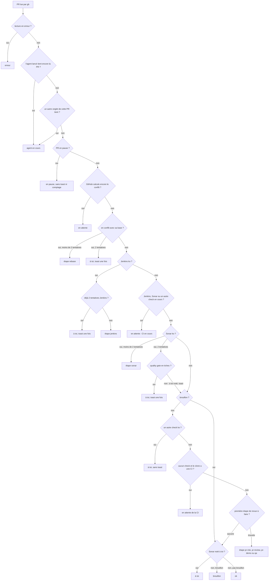
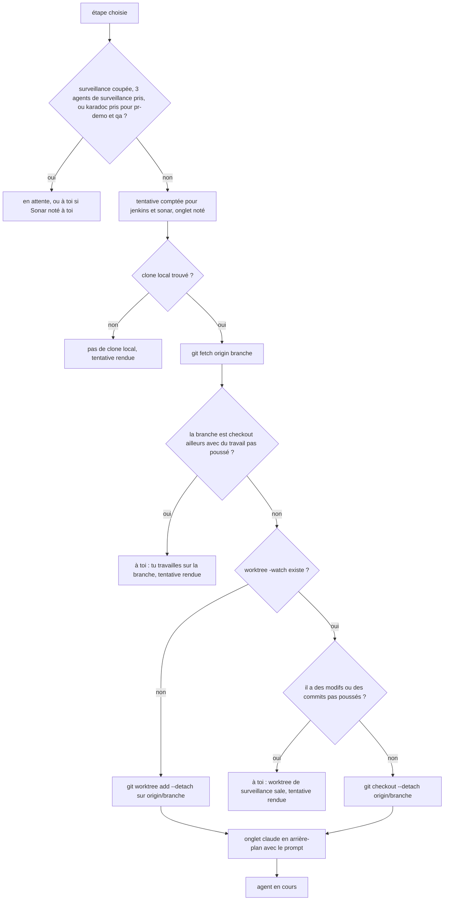

# status-jc

Clone perso du mod `workspace-status` de Herdr (version 0.1.15, voir `mod.json`), la barre d'état en bas du layout `jc`.

## Ce que fait le mod

Il affiche la barre d'état : machine, branche, nombre d'agents et combien t'attendent, puis les ports ouverts par les programmes du space affiché, et le raccourci de la palette. Il héberge aussi la surveillance des PR : toutes les 5 minutes, il lit tes PR ouvertes et lance des agents Claude dans des onglets visibles pour réparer Jenkins ou Sonar, puis pour la revue. Le panneau PR (`mods/pr/`) n'en est que l'affichage et l'interrupteur. Il fusionne aussi, toutes les minutes, les PR armées depuis le panneau dès que leurs checks sont verts (voir « Merge armé »).

## Barre d'état

De gauche à droite :

- `This computer` (ou le nom de la machine pour un space distant), la branche du space ;
- `N agents`, et `· N needs you` pour les agents `blocked`. Ce nombre part aussi en pastille sur l'icône du Dock (`setBadge`, rappelé seulement quand il change) ;
- les ports du space affiché, triés : point vert plein = répond, cercle qui clignote = démarre. Un clic ouvre `http://localhost:<port>/` ;
- le raccourci de la palette tel qu'il est vraiment lié dans `keys.json` (`commands` seul s'il n'y en a pas). Un clic l'ouvre.

Les icônes viennent de `mods/workspace-chrome/*.svg` (mod livré par Herdr).

Les ports sont relus toutes les 5 s, et tout de suite quand tu changes de space :

1. `lsof -nP -iTCP -sTCP:LISTEN -Fpn` donne les process qui écoutent et leurs ports. Les ports à partir de 32768 (éphémères : démons, aides d'IDE) sont ignorés.
2. `ps -axo pid=,ppid=` et `lsof -a -d cwd` donnent les parents et le dossier courant de chaque process. Ces deux réponses sont réutilisées tant qu'aucun nouveau listener n'apparaît, pendant une minute au plus.
3. Le space d'un listener : le premier terminal Herdr parmi ses ancêtres (`npm run dev` lancé dans un tab). Sinon, le space dont un pane a pour dossier le plus profond qui contient son dossier courant (un JVM lancé par le démon Gradle n'est pas un descendant, mais tourne dans le worktree). Les spaces distants et les panes ouverts sur `~` ne comptent pas.
4. Seuls les ports du space affiché sont interrogés par `curl -m 2 http://127.0.0.1:<port>/` : un port inconnu ou pas encore `up` à chaque tour, un port `up` toutes les 30 s.
5. `up` si le code HTTP est entre 1 et 499, ou si curl sort en 52/56 (réponse vide ou coupée : une base de données, pas du HTTP, mais le port est ouvert). Tout le reste (500+, refus, timeout) : `starting`.

## Surveillance des PR

### Quand et quoi

Un premier tour 60 s après le démarrage du mod, puis toutes les 5 min. Les tours tournent aussi surveillance coupée : le panneau reste à jour, mais aucun agent ne part.

Un tour prend un bail `shared("pr-watch-lease")` : si une autre copie du mod en tient un de moins de 4 min, le tour ne fait rien. Il lit ensuite :

- `gh search prs --author=@me --state=open --owner=softwarevidal --updated=>=<aujourd'hui - 7 j>` : une PR sans activité depuis 7 jours sort de la liste (et du panneau) ;
- pour chaque PR, `gh pr view --json ...` (checks, commentaires, reviews) et `gh api .../commits/<sha>/check-runs` (Sonar) ;
- pour chaque dépôt, son clone local (dossiers des spaces locaux et de leurs panes, `~/dev/agents-worktree/<repo>/*`, `/Volumes/sourcecode/<repo>`, reconnu par son remote `origin`), s'il a une CI (`Jenkinsfile` ou `.github/workflows/` dans le checkout principal), une section `## Demo` dans `AGENTS.md` ou `CLAUDE.md`, et le skill QA (`testing-api-pull-requests` dont `references/report.md` porte le marqueur, sous `.agents/` ou `.claude/`).

Jenkins = un check dont l'URL est un build Jenkins (un contexte `ko` l'emporte s'il y en a plusieurs). Sonar = le check-run `SonarCloud Code Analysis` ou `SonarQube Code Analysis` : `ko` si sa conclusion est `failure` ou si son résumé annonce au moins une nouvelle issue ou un hotspot. Un check Jenkins ou Sonar déjà vu sur un ancien commit et absent du nouveau compte comme « en cours ». Les marqueurs (`<!-- pr-risk -->`, `<!-- pr-review -->`, `<!-- pr-demo -->`, `<!-- testing-api-pull-requests -->`) ne comptent qu'en tête de tes propres commentaires ou reviews.

### Décision pour une PR

`decide()` dans `watch.js`. Une PR en conflit avec sa base (`mergeable` à `CONFLICTING`) passe avant tout : GitHub n'y lance aucune CI. Tant que GitHub répond `UNKNOWN` (juste après un push sur la base), la PR attend sans rien lancer ni remettre à 0. L'agent `rebase` rebase sur `origin/<base>` sans autosquash et pousse en `--force-with-lease` sur le commit d'où il est parti ; un conflit ambigu, il abandonne. Ses tentatives repartent à 0 dès que la PR n'est plus en conflit. Son push change le head : un merge armé sur la PR est désarmé. Ton checkout de la branche, à jour avant ce push, ne compte pas comme du travail non poussé (les anciennes positions de `origin/<branche>` sont exclues). Les tentatives Jenkins et Sonar repartent à 0 quand le check est vert ou quand un nouveau commit arrive sans qu'un onglet d'agent correcteur de la PR (rebase, jenkins, sonar, pr-review) soit ouvert : c'est ton push. Un commit apparu pendant que cet onglet existe est celui de l'agent, le budget reste.



L'étape de revue est la première, dans l'ordre `pr-risk`, `pr-review`, `pr-demo`, `qa`, qui n'a pas son marqueur sur la PR et n'a pas été fermée sans commentaire sur ce commit. `pr-demo` seulement si `AGENTS.md` ou `CLAUDE.md` à la racine du clone a une section `## Demo` (le skill s'arrête sans elle), `qa` seulement si le clone a le skill avec son marqueur. Un brouillon n'a jamais de revue, même avec un check en échec : il reste « brouillon ».

« L'agent lancé tient encore » : une étape de correction (rebase, jenkins, sonar) tant que son agent est `working` ou `blocked` ; `pr-review` tant que son onglet existe (il pose son marqueur avant de corriger) ; les autres étapes de revue tant que leur onglet existe sans leur marqueur. Une étape de revue dont l'onglet est fermé sans marqueur est notée « fermée sans commentaire » pour ce commit : elle ne repart pas, la suivante peut partir, et un nouveau commit la relance.

### Lancement d'une étape



Une erreur git pendant la préparation donne « erreur », tentative rendue. Le worktree est `~/dev/agents-worktree/<repo>/<branche>-watch`. L'onglet s'appelle `⟳ #<n> <étape>` ; il s'ouvre dans le space déjà ouvert sur ce dossier, sinon dans un nouveau space, sans prendre le focus. Le prompt (`promptFor`) : jenkins lit le log avec `jk log` puis corrige et pousse, ou relance avec `jk run rerun` ; sonar corrige toutes les issues et hotspots ; puis `/pr-review <url> --fix`, `/pr-demo <url> --narrate` en français, `/testing-api-pull-requests <url>` arrêté au rapport. Les pushes passent par `git push origin HEAD:refs/heads/<branche>`. Une fois son marqueur posté et son agent arrêté, l'onglet `pr-risk` se ferme au tour suivant (surveillance allumée), et son space avec s'il était son seul onglet ; de même quand la PR a été mergée ou fermée entre-temps. Jamais l'onglet affiché à l'écran, ni un onglet où tu as ouvert un autre pane. La PR d'un onglet se retrouve par son numéro et le dossier de son space (`…/agents-worktree/<repo>/<branche>-watch`). Les autres étapes gardent leur onglet : `pr-review --fix` pousse après son marqueur.

Pas d'autre ménage : à part l'onglet `pr-risk`, la surveillance ne ferme aucun onglet et ne supprime aucun worktree. C'est à toi de fermer les autres onglets `⟳`. Le seul toast est celui de « à toi » sur Jenkins ou Sonar après 2 tentatives (une fois par check, jusqu'au retour au vert ou à ton push).

## Le registre `shared("pr-watch")`

```js
{
  on: false,          // interrupteur Surveillance ; un registre neuf démarre coupé
  paused: ["owner/repo#N"],
  at: 1763300000000,  // fin du dernier tour (ms)
  error: null,        // erreur du tour entier (gh search, gh api user)
  prs: {
    "owner/repo#N": {
      url, title, head,                  // dernier commit de tête vu
      attempts: { jenkins: 0, sonar: 0 },
      told: { jenkins: false, sonar: false }, // toast « à toi » déjà montré
      seen: { jenkins: false, sonar: false }, // ce check a déjà rapporté sur la PR
      launched: { step, head, tab } | null,   // étape en cours ou dernière lancée
      silent: { "<sha>": ["pr-demo"] },       // fermées sans commentaire, commit courant seulement
      label, why, error,                      // étiquette, ligne d'explication, erreur de la PR
    },
  },
}
```

status-jc réécrit tout le registre en fin de tour, sauf `on` et `paused` qu'il relit juste avant d'écrire pour ne pas écraser un clic fait pendant le tour. `prs` est reconstruit à chaque tour avec les seules PR trouvées par la recherche. Le panneau PR lit `prs`, `at` et `error`, et n'écrit que `on` (interrupteur) et `paused` (bouton ⏸ / ▶). Il trie les lignes par étiquette : à toi, erreur, pas de clone local, agent en cours, en attente, brouillon, en pause, ok. Un clic sur une ligne va à l'agent de `launched.tab` s'il existe, sinon ouvre la PR.

`shared("pr-watch-lease")` vaut `{ at, id }` pendant un tour, `null` sinon.

## Merge armé

Le bouton « Merger quand tout est vert » du résumé de la PR (panneau `pr`) écrit la PR dans `shared("pr-merge")` : `{ "<owner>/<repo>#<N>": { head, at, why, error } }`, `head` étant le commit de tête au moment du clic, et `at` l'heure du clic. Ce mod le relit toutes les minutes, sans appel gh si rien n'est armé, que la surveillance soit coupée ou non et quel que soit l'auteur de la PR. Pour chaque PR, `gh pr view --json state,headRefOid,statusCheckRollup,commits` puis `mergeStep` :

| Situation | Effet |
|---|---|
| PR fusionnée ou fermée | désarmée, sans toast |
| commit de tête ≠ celui armé | désarmée, toast « nouveau commit, merge annulé » |
| un commit `fixup!`, `amend!` ou `squash!` | désarmée, toast |
| aucun check, un check en cours ou en échec | on attend (`why` le dit au panneau) ; un build instable relancé peut repasser vert |
| un `Jenkinsfile` au commit de tête, mais Jenkins n'a pas encore rapporté (build en file) | on attend |
| tout vert | `gh pr merge --rebase --match-head-commit <head armé>` ; succès : désarmée, toast « fusionnée » (un échec sur une PR déjà `MERGED` compte comme un succès) ; refus : toast « merge refusé », l'entrée reste avec `refused` et l'erreur, plus jamais retentée, jusqu'au ✕ du panneau |
| `gh pr view` échoue | toujours armée, `error` gardée, sans toast |

En fin de tour, `applyResults` ne modifie une entrée que si son `at` n'a pas changé : un désarmement ou un nouvel armement fait pendant le tour l'emporte. Le tour revérifie aussi `at` juste avant un toast ou un merge. Un bail `shared("pr-merge-lease")`, renouvelé à chaque PR, évite deux merges par deux copies du mod.

## Travailler sur une PR

Le bouton ⌨ « Travailler dessus » d'une ligne de la Surveillance (panneau PR) écrit `{ state: "asked" }` sous la clé de la PR (`owner/repo#N`) dans `shared("pr-open")`. Un minuteur de 5 s (`opener.js`) la prend, une à la fois :

| PR | Worktree | Pause |
|---|---|---|
| brouillon | celui de la branche ; sinon `wt switch <branche> --no-cd` le crée | aucune (la surveillance ne fait rien sur un brouillon) |
| prête | `…/agents-worktree/<repo>/<branche>-watch` tel quel, jamais remis sur origin ; absent : recréé détaché sur `origin/<branche>` | ajoutée à `pr-watch.paused`, entrée `held` avec le dossier |

Un espace local déjà sur ce dossier est sélectionné, sinon un espace s'ouvre avec `claude`. Dès qu'aucun espace local (son dossier ou le cwd d'une de ses panes, sous-dossiers compris, `~/dev` comme `/Volumes/sourcecode`) ne montre plus le dossier d'une entrée `held`, la pause est levée et l'entrée effacée ; rien n'est levé tant que le layout local n'est pas lu (démarrage, reconnexion). Une PR déjà en pause à la main n'est pas `held` : elle reste en pause. Un nouveau clic sur une PR `held` garde la pause à l'ouverture, même si la réouverture échoue. Un tour de surveillance relit la pause juste avant de décider puis avant de lancer : un clic pendant le tour suffit. Une erreur (pas de clone local, gh, git, wt) devient `{ state: "error", error }`, affichée 5 min sur la ligne ; rien n'est ouvert ni mis en pause.

Deux copies de `status-jc` : la demande passe à `opening` avec l'id de la copie avant tout appel, l'autre la laisse. Une ouverture de plus de 15 min (copie morte) redevient demandée. L'état vit hors de `pr-watch` : le tour de surveillance réécrit ce registre en fin de tour (il garde `on` et `paused`).

## Journal

Chaque tour de surveillance et chaque merge armé ajoutent leurs lignes à `~/Library/Logs/herdr-watch.log` (`AAAA-MM-JJ HH:MM  owner/repo#N  texte`, `-` à la place de la PR pour l'interrupteur), que le panneau Journal (`mods/journal/`) affiche. Au plus une ligne par PR et par tour, et seulement surveillance active : un agent lancé (`agent <étape> lancé`, même quand deux s'enchaînent sous « agent en cours »), sinon un changement d'étiquette (`<étiquette> : <pourquoi>`, ce qui dit aussi la fin d'un agent), sinon le toast du tour. Une PR nouvelle écrit son état, une PR qui sort de la recherche `sortie de la surveillance`. L'interrupteur est écrit au tour suivant, en comparant `on` au `journalOn` gardé dans le registre (jusqu'à 5 min de retard, un aller-retour rapide est perdu). Le merge écrit `fusionnée` ou `merge refusé : <erreur>`. Une écriture ratée part dans la console du mod, le tour continue. Après chaque écriture, le nombre de lignes du fichier (`wc -l`) part dans `shared("journal-lines")` pour la pastille du bouton Journal. Le fichier n'est jamais tronqué.

## Fichiers et tests

| Fichier | Rôle |
|---|---|
| `mod.json` | Origine du clone (`workspace-status` 0.1.15). |
| `main.js` | La vue : barre d'état, minuteurs des ports (5 s), de la surveillance (60 s puis 5 min) du merge armé (1 min) et des ouvertures (5 s), écriture du registre. |
| `ports.js` | Fonctions pures des ports : lecture de lsof et ps, space d'un listener, santé, quoi interroger. |
| `watch.js` | Fonctions pures de la surveillance : signaux d'une PR, `decide`, prompts, lecture de git. Sans import Herdr. |
| `watcher.js` | Un tour : bail, appels gh et git, clone local, worktree `-watch`, ouverture des onglets. |
| `merge.js` | Fonctions pures du merge armé : `mergeStep`, `applyResults`. Sans import Herdr. |
| `merger.js` | Un tour de merge armé : bail, appels gh, toasts. |
| `open.js` | Fonctions pures de l'ouverture : chemin du `-watch`, pause posée, pauses à lever. Sans import Herdr. |
| `opener.js` | Un passage d'ouverture : demande, gh, worktree, espace, pause. |
| `journal.js` | Fonctions pures du journal : lignes d'un tour, format d'une ligne. Sans import Herdr. |
| `journal-file.js` | Ajout des lignes au fichier du journal. |
| `ports.test.mjs`, `watch.test.mjs`, `merge.test.mjs`, `open.test.mjs`, `journal.test.mjs` | Tests `node:test` des fichiers purs. |

```sh
node --test ~/.config/herdr-app/mods/status-jc/*.test.mjs
herdr-app check ~/.config/herdr-app/mods/status-jc
```

`watcher.js`, `merger.js` et `main.js` n'ont pas de test : ils parlent à Herdr, gh et git.

## À savoir

- Herdr refuse un import hors du dossier du mod (`resolves outside the application directory`). D'où `jenkinsBuild` et `checks` copiés depuis `mods/pr/model.js`, et les étiquettes recopiées dans le panneau : renommer une étiquette dans `LABELS` sans toucher `looks` de `mods/pr/main.js` la classe en dernier.
- `shared()` est persisté par Herdr dans `~/.config/herdr-app/shared.json` : le registre, l'interrupteur et les pauses survivent à un redémarrage. La pause n'est jamais nettoyée, exprès : une PR calme sortirait de la recherche à 7 jours et perdrait sa pause.
- La surveillance est ici et pas dans le panneau parce qu'une copie de mod ne démarre qu'à son premier affichage ; la barre d'état est toujours affichée dans `jc`. Deux copies (deux fenêtres, changement de layout) : le bail évite les doubles lancements.
- `tab.new` ne rend pas d'id : les onglets sont retrouvés par leur nom `⟳ #<n> <étape>`. Ne pas les renommer.
- Un Claude qui attend une réponse texte (scénario de `pr-demo` à approuver) se lit `idle` ou `done`, pas `blocked` : d'où les étapes de revue qui tiennent la PR tant que leur onglet existe.
- Pas de `structuredClone` dans le runtime Herdr : `decide` copie l'entrée en JSON. Pas de `setTimeout` : `cx.timer`.
- `pr-demo` et `qa` démarrent karadoc sur des ports fixes : un seul des deux à la fois, toutes PR confondues, et seulement pour un repo dont le clone a un dossier `karadoc/` (arthur) ; ailleurs (ordostruct…) ils partent sans attendre karadoc.
- Jenkins n'est lisible qu'avec le VPN ; sans, l'agent jenkins doit le dire et s'arrêter.
- Le login GitHub (`gh api user`) et les clones trouvés sont gardés en mémoire jusqu'au redémarrage du mod.
- Un worktree `-watch` laissé avec du travail pas poussé bloque la PR en « à toi » jusqu'à ce que tu le pousses ou le nettoies.

## Conception

- [Surveillance des PR](../../docs/2026-11-14-pr-watch-design.md) et son [plan](../../docs/2026-11-14-pr-watch-plan.md)
- [Mettre une PR en pause](../../docs/2026-11-16-pr-watch-pause-design.md)
- [Ne pas lancer d'agent sur une branche où je travaille](../../docs/2026-11-16-pr-watch-busy-branch-design.md)
- [Merge armé](../../docs/2026-11-17-pr-armed-merge-design.md)
- [Journal](../../docs/2026-11-18-watch-journal-design.md)

Les conceptions peuvent être en retard sur le code : le code fait foi.
